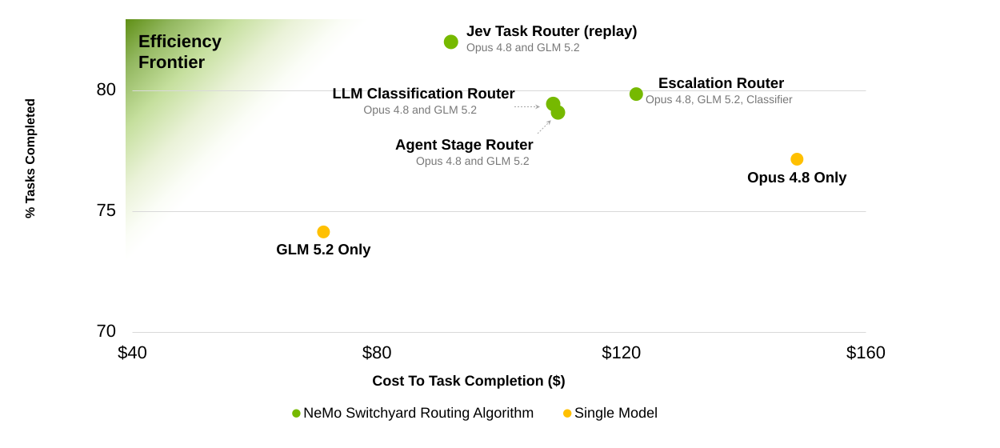
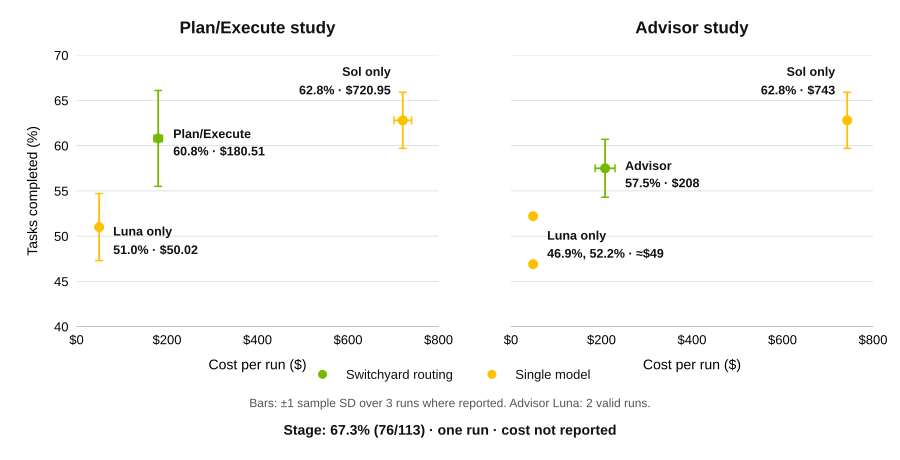

# Benchmarks

Compare task completion and cost, open the routing configs, and run a benchmark with your own model endpoints.

[Terminal-Bench 2.1](#terminal-bench-21) · [DeepSWE](#deepswe) · [Run a benchmark](#run-a-benchmark)

The linked configs use the current Switchyard schema and OpenRouter endpoints, including Jev.
All use `OPENROUTER_API_KEY`. The recorded results used the original evaluation stacks.
Changing the provider, models, or routing settings can change the outcome.

## Terminal-Bench 2.1

The published comparison routes between **Claude Opus 4.8** and **GLM 5.2**, with each model
also measured on its own. The escalation route uses **DeepSeek V4 Flash** as its judge.

[Published comparison and background](https://developer.nvidia.com/blog/route-ai-agent-workloads-across-models-with-nvidia-nemo-switchyard/).

Configs: [Escalation](../benchmark/routing-profiles/tb21-escalation-opus-glm-deepseek.toml) ·
[Jev task router](../benchmark/routing-profiles/tb21-jev-opus-glm.toml)

The Jev point is a recorded-run replay: **73/89 tasks (82.02%)** at an estimated **$92.12**,
including Jev calls. Jev selects one model for each task and replays its recorded outcome.
Its evaluation setup and cost accounting differ from the other points.

The replay includes **62 training tasks** and a reused **27-task test split** (Jev: 22/27;
paired Opus baseline: 23/27). The Jev config uses a different question and endpoints; it needs
a fresh benchmark.

## DeepSWE

**DeepSWE v1.1 · 113 tasks · Codex CLI · GPT-5.6 Luna and Sol**

Plan/Execute uses Sol to plan and Luna to execute. Advisor uses Luna to execute and Sol to
review. Stage chooses between the two models from recent tool activity.

[Evaluation settings](../benchmark/DEEPSWE_V11_QUALIFICATION.md).

Configs: [Plan/Execute](../benchmark/routing-profiles/deepswe-v11-plan-execute-luna-sol.toml) ·
[Advisor](../benchmark/routing-profiles/deepswe-v11-advisor-gate-luna-sol.toml) ·
[Stage](../benchmark/routing-profiles/deepswe-v11-stage-router-luna-sol.toml)

Points show three-run means, except the two individual Advisor Luna runs. Labels identify
each study's baselines. Stage has no paired single-model baseline. The config headers record
the results and sample standard deviations.

All runs used closed-book evaluation, a three-hour agent budget, and strict scoring:
failures and missing results count as unsolved.

## Run a benchmark

- **Terminal-Bench 2.1:** [Prepare the dataset](../benchmark/README.md#one-time-setup),
  [run with a config above](../benchmark/README.md#run-with-switchyard-routing), and
  [inspect the artifacts](../benchmark/README.md#inspect-a-run).
- **DeepSWE:** [Run with Pier](../benchmark/README.md#deepswe-v11).
