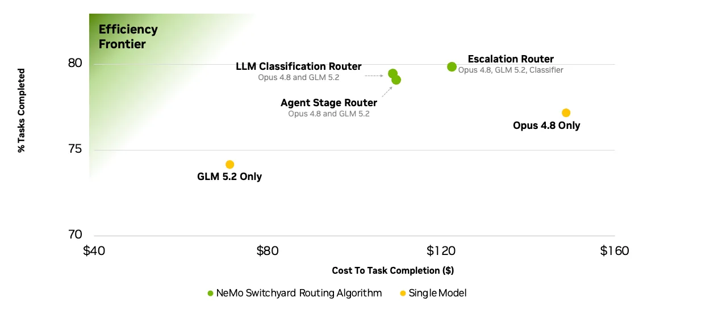

# Benchmarks

Compare task completion and cost, open the routing configs, and run a benchmark with your own model endpoints.

[Terminal-Bench 2.1](#terminal-bench-21) · [DeepSWE](#deepswe) · [Run a benchmark](#run-a-benchmark)

The linked configs use the current Switchyard schema and OpenRouter endpoints. The recorded
results used the original evaluation stacks. Changing the provider, models, or routing settings
can change the outcome.

## Terminal-Bench 2.1

The published comparison routes between **Claude Opus 4.8** and **GLM 5.2**, with each model
also measured on its own. The escalation route uses **DeepSeek V4 Flash** as its judge.

[Published comparison and background](https://developer.nvidia.com/blog/route-ai-agent-workloads-across-models-with-nvidia-nemo-switchyard/).

[Escalation config](../benchmark/routing-profiles/tb21-escalation-opus-glm-deepseek.toml)

### Jev task routing

This separate experiment uses Jev to choose Opus 4.8 or GLM 5.2 for the whole task, then
replays their recorded outcomes.

| Evaluation | Tasks solved | Estimated model cost | Config |
| --- | --- | --- | --- |
| Recorded-run replay | 73/89 (82.02%) | $92.12, including Jev calls | [Adapted TOML](../benchmark/routing-profiles/tb21-jev-opus-glm.toml) |

The 89 tasks include **62 training tasks** and a reused **27-task test split**. On that test
split, Jev solved 22/27 tasks and its paired Opus baseline solved 23/27. The serving setup and
cost accounting differ from the chart above. The adapted config uses a different question and
endpoints; a fresh benchmark of that config is still needed.

Source: [recorded replay figures and evaluation notes](../assets/switchyard-cost-accuracy.svg).

## DeepSWE

**DeepSWE v1.1 · 113 tasks · Codex CLI · GPT-5.6 Luna and Sol**

Plan/Execute uses Sol to plan and Luna to execute. Advisor uses Luna to execute and Sol to
review. Stage chooses between the two models from recent tool activity.

| Routing strategy | Tasks solved | Cost per run | Config |
| --- | --- | --- | --- |
| Plan/Execute | 60.8% ± 5.3 | $180.51 ± 9.43 | [TOML](../benchmark/routing-profiles/deepswe-v11-plan-execute-luna-sol.toml) |
| Advisor | 57.5% ± 3.2 | $208 ± 22 | [TOML](../benchmark/routing-profiles/deepswe-v11-advisor-gate-luna-sol.toml) |
| Stage | 76/113 (67.3%) | Not reported | [TOML](../benchmark/routing-profiles/deepswe-v11-stage-router-luna-sol.toml) |

Plan/Execute and Advisor report the mean ± sample standard deviation over three runs. Stage
reports one run. All use strict scoring: failures and missing results count as unsolved.

The single-model baselines belong to their respective studies:

| Study | Sol alone | Luna alone |
| --- | --- | --- |
| Plan/Execute | 62.8% ± 3.1; $720.95 ± 19.47/run | 51.0% ± 3.7; $50.02 ± 1.04/run |
| Advisor | 62.8% ± 3.1; $743/run | 46.9% and 52.2%; about $49/run (two valid runs) |

The Stage run has no paired single-model baseline. These studies used closed-book evaluation
and a three-hour agent budget. The config headers record each result; the
[evaluation settings](../benchmark/DEEPSWE_V11_QUALIFICATION.md) cover versions, timeouts,
scoring, and pricing.

## Run a benchmark

- **Terminal-Bench 2.1:** [Prepare the dataset](../benchmark/README.md#one-time-setup),
  [run with a config above](../benchmark/README.md#run-with-switchyard-routing), and
  [inspect the artifacts](../benchmark/README.md#inspect-a-run).
- **DeepSWE:** [Run with Pier](../benchmark/README.md#deepswe-v11).
