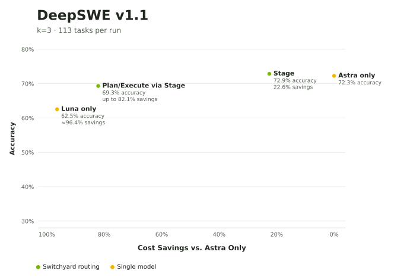
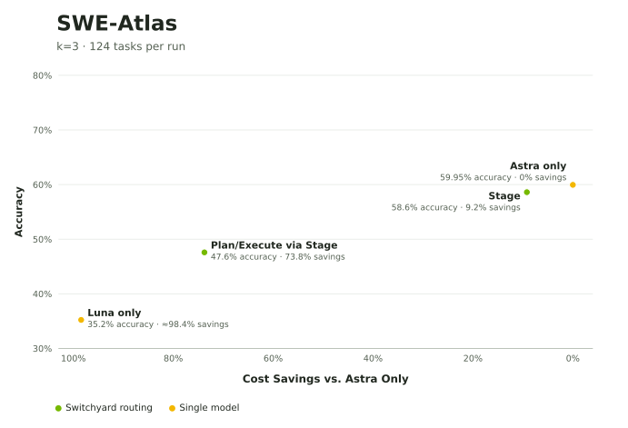
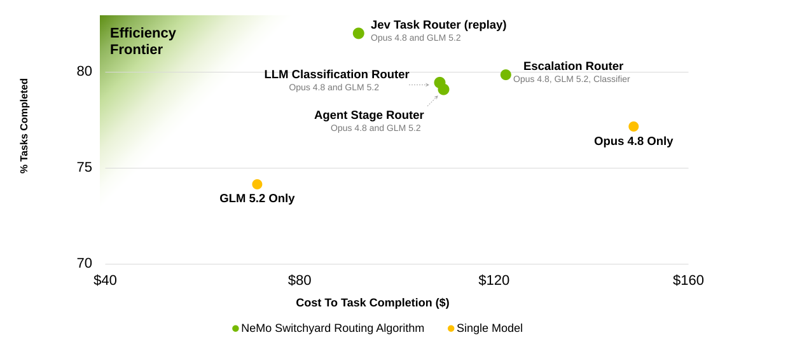
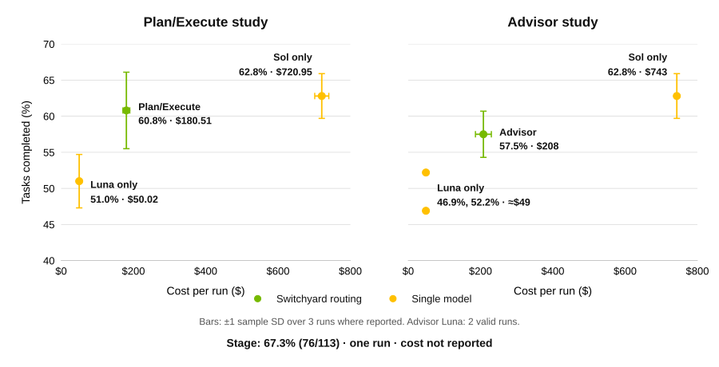

# Benchmarks

[DeepSWE v1.1](#deepswe-v11) · [SWE-Atlas-QnA](#swe-atlas-qna) · [Earlier benchmarks](#earlier-benchmarks) · [Run a benchmark](#run-a-benchmark)

## DeepSWE v1.1

**GPT-6 Astra and GPT-6 Luna · 113 coding tasks per run**

Codex CLI 0.158.0 ran each configuration three times with both models at max
reasoning effort. Accuracy counts every task, including execution errors.
Savings compare estimated solver costs per full run with Astra alone, excluding
judges and infrastructure.

| Strategy | Tasks solved across 3 runs | Accuracy | Cost Savings vs. Astra Only |
| --- | ---: | ---: | ---: |
| Luna only | 212/339 | 62.54% | 96.4% |
| [Plan/Execute via Stage](../benchmark/DEEPSWE_V11_QUALIFICATION.md#astra-planner-and-luna-executor) | 235/339 | 69.32% | 82.1% |
| Stage | 247/339 | 72.86% | 22.6% |
| Astra only | 245/339 | 72.27% | 0% |

Stage started on Luna and could switch to Astra after tool errors or when
Codex compacted context. [Plan/Execute via Stage](routing_algorithms/stage_router_routing.md#plan-and-execute)
used Astra to plan and Luna to execute.

## SWE-Atlas-QnA

**GPT-6 Astra and GPT-6 Luna · Artificial Analysis (AA) variant · 124 tasks per run**

These results use the same Codex version, max reasoning effort, and three-run
scoring as DeepSWE. Stage started on Astra and solved 218 of 372 task
attempts. The 18 execution errors count as failures.

| Strategy | Tasks solved across 3 runs | Accuracy | Cost Savings vs. Astra Only |
| --- | ---: | ---: | ---: |
| Luna only | 131/372 | 35.22% | 98.4% |
| Plan/Execute via Stage | 177/372 | 47.58% | 73.8% |
| Stage | 218/372 | 58.60% | 9.2% |
| Astra only | 223/372 | 59.95% | 0% |

## Earlier benchmarks

### Terminal-Bench 2.1

**Claude Opus 4.8 and GLM 5.2**

| Strategy | Tasks solved | Cost per run | Config |
| --- | ---: | ---: | --- |
| LLM classifier | 79.40% | $109.04 | |
| Stage | 79.03% | $109.81 | |
| Escalation | 79.80% | $122.63 | [TOML](../benchmark/routing-profiles/tb21-escalation-opus-glm-deepseek.toml) |
| Jev (replay) | 82.02% | ≈$92.12 | [TOML](../benchmark/routing-profiles/tb21-jev-opus-glm.toml) |
| Opus 4.8 only | 77.15% | $148.83 | |
| GLM 5.2 only | 74.16% | $71.31 | |

### DeepSWE

**v1.1 · 113 tasks · Codex CLI · GPT-5.6 Luna + Sol**

| Strategy | Tasks solved | Cost per run | Config |
| --- | ---: | ---: | --- |
| Plan/Execute (standalone, removed) | 60.8% | $180.51 | [Historical config](../benchmark/DEEPSWE_V11_QUALIFICATION.md#historical-planexecute-configuration) |
| Advisor | 57.5% | $208.00 | [TOML](../benchmark/routing-profiles/deepswe-v11-advisor-gate-luna-sol.toml) |
| Stage | 61.36% | $466.28 | [TOML](../benchmark/routing-profiles/deepswe-v11-stage-router-luna-sol.toml) |
| Sol only | 62.8% | $720.95 | — |
| Luna only | 52.2% | ≈$49 | — |

Luna: one run; others: three-run means. [Evaluation settings](../benchmark/DEEPSWE_V11_QUALIFICATION.md).

The Plan/Execute result used the removed standalone implementation. Its archived
config requires an older Switchyard version. The [GPT-6 results above](#deepswe-v11)
use the current Plan/Execute configuration for Stage.

## Run a benchmark

The linked OpenRouter configs use `OPENROUTER_API_KEY`.

- **Terminal-Bench 2.1:** [Setup](../benchmark/README.md#one-time-setup) · [Run](../benchmark/README.md#run-with-switchyard-routing)
- **DeepSWE:** [Run Codex through Switchyard locally](../benchmark/README.md#deepswe-v11)
