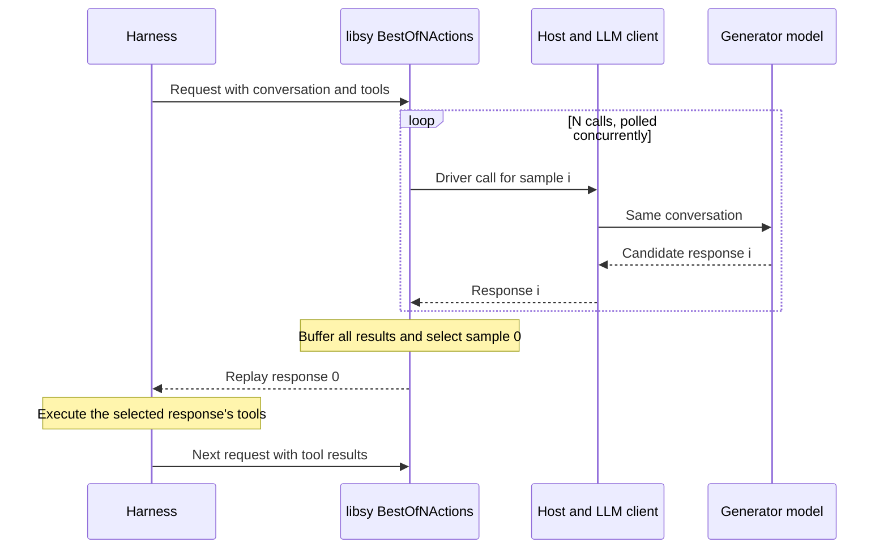

# Best of N action sampling in Switchyard

Status: initial implementation. The algorithm samples several next actions and
always returns the first sample. Scoring is a later change. See
[Best of N Actions](../routing_algorithms/best_of_n_actions.md) for configuration.

Add a `BestOfNActions` algorithm to `libsy`. For each incoming request from a
tool-using agent harness, it asks one configured model for `N` candidate next
actions in separate calls to the same conversation. Each candidate arrives as
an assistant response. It buffers those responses, then returns sample `0`
unchanged. The harness executes the selected response's tool calls as usual.

“First” means the first request in sample order, even if another request finishes
earlier. Put the future selection logic at one explicit point after generation.
This first version establishes the sampling and response delivery behavior; it
does not claim a quality improvement over one sample.

## Relationship to Mid Harness

[Mid-Harness](https://arxiv.org/abs/2609.39982) samples alternative actions from
the same history, selects one, and lets the existing harness execute it. The
[project page](https://byungkwanlee.github.io/MidHarness-page/) illustrates this
boundary. Switchyard can own sampling and selection while the harness continues
to own execution and the next conversation turn.

The paper compares three verification methods: one call to compare the whole
set, independent scoring of each candidate, and pairwise comparisons. It finds
that verifier quality matters: extra samples alone bring little benefit with
weak verification. Pairwise comparison works best among the evaluated
self-verification methods. These results motivate a later selection experiment;
the initial implementation below deliberately has no verifier.
[Paper, sections 2 and 4](https://arxiv.org/html/2609.39982v1#S2).

## Request flow



The algorithm runs once per incoming model request. It keeps no session history
of its own. Each later invocation gets the history supplied by the harness,
including the selected response and any tool results.

A candidate action is carried by a **complete assistant response**. It may
contain text, reasoning blocks, and several tool calls. Keep that response
together. Picking one tool call from one response and another from a different
response could break their ordering or assumptions. Selecting one candidate can
therefore return several tool calls that the harness executes together.

The scope is choosing a tool-using agent's next action. A completion decision is
also a candidate: the paper's verifier prompts explicitly judge whether the
agent should finish. It is therefore too narrow to require every candidate to
contain a tool call. Preserve a completion response even when it has no tool
calls; the initial selection rule still returns sample `0`.
[Paper, verifier prompts](https://arxiv.org/html/2609.39982v1).

## Existing components to reuse

| Component | Use in this design |
|---|---|
| [`Algorithm::route` and `Driver`](../../crates/libsy/src/core/algorithm.rs) | Implement the algorithm and request each generation from the host. |
| `Algorithm::run_stream` and `drive` | Already support multiple outstanding calls and cancellation. Keep their execution loop. |
| [`buffer_response`](../../crates/libsy/src/algorithms/util/buffered_response.rs) | Inspect a completed response while retaining its original stream events. |
| `RoutingOutcome::answered` | Return the sampled response directly, avoiding another model call after selection. |
| [`libsy-llm-client::run`](../../crates/libsy-llm-client/src/run.rs) | Execute calls using the existing provider clients and return the supplied answer. |
| [`AlgorithmSpec`](../../crates/switchyard-runner/src/algorithm.rs) | Parse a route and resolve its generator target into runtime models. |

The Rust implementation belongs in `Algorithm::route`. The default
`run_stream` implementation turns its calls into `Step::CallModel` events and
its result into `Step::Done`. `libsy` continues to make no HTTP requests itself.

The closest existing response-handling example is
[`AdvisorGate`](../../crates/libsy/src/algorithms/advisor_gate.rs), which buffers
an executor response and can release it unchanged. Reuse the buffering helper,
without adding the advisor's review policy or session state.

## First implementation

Add `BestOfNActions` and `BestOfNActionsConfig` in
`crates/libsy/src/algorithms/best_of_n_actions.rs`, and export them through the existing
algorithm and crate modules.

The configuration needs only:

| Field | Meaning |
|---|---|
| `num_candidates` | Number of separate generation calls. Must be at least one. |
| `temperature` | Sampling temperature, default `0.8`. Overrides the caller's value, including when `N = 1`. |
| `candidate_timeout_ms` | Deadline for each complete candidate when `N > 1`, including draining its stream. Must be positive. |

The runner additionally accepts `generator_target`. Resolve it into a single
entry in `Category::Any`. `libsy` gets the model from
`driver.first_model_for(&Category::Any)`.

Use `N = 4` and a 60-second candidate deadline for an initial experiment. These
are starting settings, not measured recommendations. Set temperature to `0.8`
by default and allow a route override. Keep model output limits, tools, tool
choice, and reasoning settings from the incoming request and existing client
configuration.

Use one model call per sample. A provider's native `n` option can return multiple
choices with different response shapes, so it is outside this first version.
Require incoming native `n` to be absent or `1` when sampling. Separate requests
avoid adding a multiple-choice response contract to the protocol.

The core control flow is approximately:

```rust
// Sketch inside Algorithm::route; helper details are omitted.
let generator = driver.first_model_for(&Category::Any)?.clone();
request.llm_request.sampling.temperature = Some(self.config.temperature);
drop_exact_replay(&mut request);
request.raw_request = None;

if self.config.num_candidates == 1 {
    return Ok(RoutingOutcome::route_to(generator, vec![], request));
}

let calls = (0..self.config.num_candidates).map(|sample_index| {
    let driver = driver.clone();
    let generator = generator.clone();
    let candidate_request = request.clone();

    async move {
        let result = tokio::time::timeout(candidate_timeout, async {
            let response = driver
                .call_model_with_error_recovery(
                    candidate_request,
                    vec![generator.clone()],
                    true,
                )
                .await?;
            buffer_response(generator.as_str(), response).await
        })
        .await;

        // Convert timeout to a typed call error and record this sample's result.
        (sample_index, normalize_result(result))
    }
});

// join_all polls calls concurrently and retains their input order.
let candidates = futures::future::join_all(calls).await;
record_candidate_results(&driver, &candidates);

// TODO: Score candidate actions and select the best response.
let (_, selected) = candidates.into_iter().next().expect("N is positive");
let selected = selected?;

Ok(RoutingOutcome::answered(
    generator,
    request,
    selected.into_response(),
))
```

`normalize_result` and `record_candidate_results` are local helper placeholders
in this sketch. No scorer trait, judge call, or selection-mode configuration is
needed for this version.

Enable call error recovery for every sampled call. Otherwise a failed extra
sample can terminate the host before the algorithm receives the other results.
Collect results instead of using a combinator that stops at the first error.

For `N = 1`, the normal completion path provides a baseline with existing
streaming behavior. For `N > 1`, wait until every candidate finishes or reaches
its deadline before selecting. This exercises the same generation phase that
later scoring will consume.

## Selection and failures

| Situation | First-version behavior |
|---|---|
| All samples succeed | Return sample `0`. |
| Another sample finishes before sample `0` | Still return sample `0`. |
| Sample `0` succeeds; an extra sample fails or times out | Record that failure, then return sample `0`. |
| Sample `0` fails or times out | Return its typed error after collecting the other results. |
| Samples are identical | Keep them; return sample `0`. |
| Sample `0` is truncated or contains an invalid tool action | Preserve its original response and stop reason; let the harness handle it as it would in a single-sample run. |
| The caller cancels | Drop outstanding calls and buffered results. |

This makes the placeholder exact: it always selects position `0`. Returning the
first successful, first complete, or first valid candidate would introduce a
different selection policy. Validation and recovery based on candidate quality
belong with the later scoring change.

Use the existing backend retry settings. `N` counts logical candidate calls;
provider retries may cause more HTTP attempts. The algorithm adds no retry or
replacement-generation loop.

## Streaming and request compatibility

For `N > 1`, hold every candidate stream until generation finishes. Replay only
sample `0` through `BufferedResponse::into_response`. The harness must receive
no text or tool-call deltas from discarded samples. Even partial tool-call
output can become externally visible state in a harness.

Preserve the selected response's IDs, tool-call IDs, signed reasoning, provider
extensions, headers, usage, and stop reasons. Do not rebuild it from extracted
text or its aggregate when original events are available. Buffered streaming
still uses the requested wire format, but its first content arrives after the
generation phase. Latency is approximately the slowest candidate duration,
bounded by the candidate deadline, plus response replay overhead.

The existing HTTP host also buffers routing streams. Reuse that behavior and
the libsy helper initially. Memory grows with `N` times the response size, with
additional aggregate data for inspection. Use finite provider output limits
and small sample counts in the prototype.

Keep candidate requests identical, with the same configured temperature and
model stamp. Preserve other caller sampling settings, including a fixed seed if
present. A fixed seed can produce identical samples. Clear stale exact request
replay data with `drop_exact_replay` so the configured temperature reaches the
provider.

Limit initial fan-out to requests whose history is present in the request and
whose tools execute in the harness:

- Ordinary text and normalized `Tool::Function` calls fit this boundary.
- Provider-executed tools, including remote MCP tools, can run during generation.
  Reject those requests before fan-out. Unknown provider tool definitions need
  explicit support before they can be sampled safely.
- Reject `previous_response_id` and `conversation` continuations for this route
  when `N > 1`. Concurrent calls must not mutate one provider conversation, and
  the future judge needs the actual history.

The continuation check must happen **before** the state-owner shortcut in both
`libsy-llm-client::run` and `decide`. That shortcut currently bypasses the
algorithm for stored state. A check only inside `BestOfNActions::route` would miss it.
`Algorithm::prepare_request` applies the check and temperature override before
that shortcut and at `run_stream` entry. It also keeps the configured temperature
on single-sample continuations. Preparation is idempotent because a request can
pass through both entry points.
Support for materializing and branching provider state is a separate extension.

## Runner configuration

Route configuration:

```toml
[routes.sampled_actions]
id = "switchyard/sampled-actions"
type = "best_of_n_actions"
generator_target = "executor"
num_candidates = 4
temperature = 0.8
candidate_timeout_ms = 60000
```

`executor` refers to an existing target. Register it as both callable and able
to produce the final response. Integrate it with the current
`routing_answer_target` prompt handling so all sampled responses receive the
same target prompt that a normal completion would receive. There is no judge
dependency yet.

The initial delivery path is the runner and Switchyard HTTP server. Their
response path already accepts `RoutingOutcome::answered`. A Python constructor
can follow if direct Python use is needed. The
[LiteLLM routing plugin](../../examples/litellm/src/switchyard_litellm/plugins/switchyard_routing_plugin.py)
currently rejects intermediate model calls and precomputed responses, so it
needs a separate integration change before supporting this algorithm.

## Observability

Attach compact evidence to the routing outcome: requested sample count,
selected index `0`, each sample's status and duration, and available token usage.
Give failures bounded reason codes. Keep candidate text out of ordinary logs.

Keep the selected response's provider usage unchanged. Extra sampling cost is
separate overhead; total known tokens are the sum across all candidates.
Missing usage remains unknown. If sample `0` fails, there is no successful
outcome metadata, so retain failure observations through the existing call
traces and a final failure event.

There is one existing accounting limitation:
`emit_routing_observations` marks the first completed call matching the answered
model as `AnswerCall`. All samples here use the same model, so that label may
identify a discarded sample. For the prototype, use explicit sample-index
evidence for candidate attribution. Before relying on generic statistics that
separate the answer from overhead, add a call ID to host observations and response metadata,
and match the returned response by that ID. A model ID cannot distinguish these
calls.

## Adding selection later

Keep the generation phase and response replay unchanged. Replace the `TODO`
with a function that returns an index into the completed candidates. It must
select an existing response; it must not generate a replacement after choosing.

The first scoring experiment can use one additional LLM call containing the
task, conversation, tool definitions, and all candidate actions. Give candidates
anonymous IDs and omit their private reasoning from the judge view. Keep the
full original response for replay. Ask for a bounded score for each ID, validate
the returned IDs and scores, then take the highest score. This is a proposed
joint-scoring variant of listwise selection, rather than an exact reproduction
of the paper's choice-only output.

The scoring change must also define eligibility, malformed-verdict behavior,
ties, judge timeouts, context limits, and the case where no candidate is usable.
Use a fresh judge request without executable tools or generator-only provider
state. Judge failure can fall back to the first usable sample, but that would
be an explicit change from the current hardcoded selection rule.

Multiple generators can follow by expanding an ordered sample plan, such as
`[(model_a, 2), (model_b, 2)]`. Here `N = 4` total. Each candidate keeps its own
model identity, and `answered` reports the selected candidate's model. This also
requires extending the host's single `routing_answer_target` handling. Once a
judge can share a model with a generator, prompt handling must distinguish call
purpose rather than relying only on model ID.

Pairwise scoring, a dedicated decision provider, and learned verifiers can use
the same buffered candidate set later. Add those only after measuring the first
scoring implementation.

## Implementation and validation

The first change should contain the algorithm, runner registration, request
compatibility checks, one example route, and focused tests. No protocol changes are
required for sampling and replay themselves. The accounting improvement above
can be a separate change.

Use fake clients to verify these behaviors before a live experiment:

1. `N = 1` makes one normal completion call. `N > 1` makes exactly `N` logical
   calls and no additional completion or judge call.
2. All candidate calls can be in flight together. They carry the same history,
   tools, output limits, and sampling settings.
3. Finish candidates out of order and verify the response from request `0` is
   returned, including when it finishes last.
4. An extra sample failure does not abort sample `0`. A sample `0` failure
   remains an error even when later candidates succeed.
5. Stream content stays private until selection. Replay preserves sample `0`'s
   provider events, tool IDs, signed blocks, headers, and usage.
6. A timeout covers stream draining as well as obtaining the response handle.
   Cancelling the run drops all pending work.
7. Runner configuration resolves the generator and applies its target prompt to
   every candidate. Unsupported stateful or provider-tool requests fail before
   any sampled call starts.

Run focused `libsy`, client, and runner tests for the implementation. Broaden
validation if shared APIs change. Live provider testing is a later explicit
experiment, with `N = 1` as the baseline and `N = 4` to measure sampling cost and
latency. Assess task success only after selection logic is implemented.
