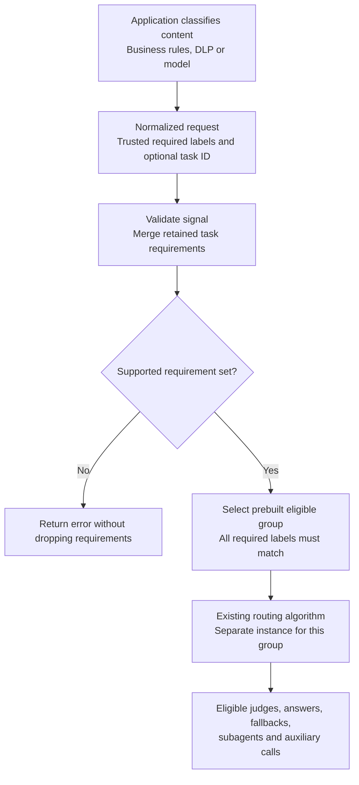

# Target eligibility

Updated 20 October 2026 for the four-PR target eligibility stack beginning with
[#924](https://github.com/NVIDIA-NeMo/Switchyard/pull/924). Built-in privacy classification has
been removed. This is proposed behavior, not a released feature.

## Problem and approach

Some requests contain personal data, credentials or governed company information that may only
go to approved model deployments. The application must be able to state those requirements
without replacing its normal routing algorithm. The requirements must also cover judges,
fallbacks and auxiliary calls that can receive the same content.

Targets declare deployment-owned labels. A trusted application supplies the labels a request
requires, and Switchyard runs the configured router using only a supported, eligible target
group. The application owns classification and endpoint approvals. It can use business rules,
DLP, a model or other checks before supplying requirements. Switchyard enforces those
requirements without deciding what counts as sensitive.

Labels are deployment-defined; there is no built-in geography vocabulary. The examples use
`customer_data` to mean approved to process customer records. Switchyard matches labels, not
the underlying approvals.

Libsy enforces allowed model IDs. Runner configures and selects execution groups and retains
task requirements. The LLM client still owns provider calls, retries and fallbacks. Existing
routing classifiers continue to choose among eligible models. No protocol, codec or Relay ABI
change is needed.



Task scope processes new requirements on every turn; a retained requirement does not bypass
ingress validation. Already-dispatched calls are not recalled.

## Labels and trusted requirements

Targets declare flat string labels. The route names the finite requirement sets
it supports; the empty set is implicit. Client definitions are omitted here.

```toml
[targets.fast]
id = "public-model"
llm_client = "public_endpoint"
labels = []

[targets.private_general]
id = "internal-general-model"
llm_client = "internal_endpoint"
labels = ["private"]

[targets.private_customer]
id = "internal-customer-model"
llm_client = "customer_endpoint"
labels = ["private", "customer_data"]

[routes.coding]
id = "switchyard/coding"
type = "random"
targets = ["fast", "private_general", "private_customer"]
weights = [3, 1, 1]

[routes.coding.eligibility]
requirement_scope = "request"

[routes.coding.eligibility.accepted_requirement_sets]
private = ["private"]
customer_data = ["customer_data"]
private_customer_data = ["private", "customer_data"]
```

The embedded application supplies requirements through the additive Rust helper:

```rust
use switchyard_runner::require_target_labels;

require_target_labels(&mut request, ["private", "customer_data"])?;
let output = route.execute(request, None).await?;
```

`require_target_labels(&mut Request, impl IntoIterator<Item = impl AsRef<str>>)` returns
`Result<(), LlmClientError>` and merges requirements into trusted internal metadata. It adds
no HTTP header, request-body field or Python binding. Adding an eligibility table enables
application requirements; routes without that table reject them.

For routes that require a signal on every request, use:

```toml
[routes.coding.eligibility]
require_explicit_requirements = true
```

`require_explicit_requirements` defaults to `false`. When it is `true`, a missing signal is rejected
before any model calls, even when the task already has retained requirements.
`mark_privacy_restricted()` signals also qualify.

The application can explicitly supply no additional requirements:

```rust
require_target_labels(&mut request, std::iter::empty::<&str>())?;
```

An empty signal does not clear retained task requirements. Presence does not prove the
application performed an assessment, and this option does not synchronize task state across
replicas. Signals remain optional on eligibility routes unless explicitly required.

Every required label must exactly match a target label; a target may have extra labels.
Each `accepted_requirement_sets` entry names a supported label set. The names also identify optional
target overrides; applications still supply labels, not those names. Order and duplicate labels
do not change a set.
In the example, `["private"]` admits both internal targets, while `["private", "customer_data"]`
admits only `private_customer`. No requirements admits all configured candidates. Only declared
requirement sets are supported; Runner does not generate other combinations.

Unknown or malformed labels fail closed. A valid but unsupported requirement set also returns an
error; Switchyard never drops a requirement or chooses a nearby requirement set to keep serving.
Completion and decision-target aliases sharing a client and model must declare the same labels.
Labels are limited to 128 bytes each, with at most 32 distinct labels per route and per target.
Routes support at most 64 canonical requirement sets, including the implicit empty set.

## Prebuilt execution groups

Runner builds a separate execution lane for each declared requirement set, using only targets
that satisfy it. The existing router still chooses among that pool, including its judges,
answer candidates, fallbacks and auxiliaries. Random keeps weights paired with their targets.
Failures never restore an ineligible target or import one from another deployment.

Fixed-role routers keep their efficient, capable and judge roles. A requirement set can bind
those existing names to approved replacements without changing the router settings. For example,
assuming the normal targets and their customer-data-approved replacements are defined:

```toml
[routes.coding_stage]
id = "switchyard/coding-stage"
type = "stage_router"
efficient_target = "fast"
capable_target = "capable"
picker = "efficient_first"
confidence_threshold = 0.5
classifier = { target = "judge", base_threshold = 0.5 }

[routes.coding_stage.eligibility]
require_explicit_requirements = true

[routes.coding_stage.eligibility.accepted_requirement_sets]
private_customer_data = ["private", "customer_data"]

[routes.coding_stage.eligibility.target_overrides.private_customer_data]
fast = "private_fast_customer"
capable = "private_capable_customer"
judge = "private_judge_customer"
```

An explicit empty signal uses the original targets. The `private` plus `customer_data`
requirements use the replacements, each of which must declare both labels. This binding is
built once at startup; model calls, prompts, fallbacks, subagent policies and auxiliary
operations use that lane's resolved targets. Decision metadata reports the replacement targets.

Mappings apply once: `fast = "private_fast_customer"` does not follow another mapping for
`private_fast_customer`. Unmapped roles must already meet the requirements. Missing replacements,
unused names, changed LLM/decision target kinds and conflicting mappings for equivalent label
sets are configuration errors. Empty-set overrides are rejected so unrestricted routing stays
unchanged. Random overrides cannot collapse distinct models onto one weighted entry.

The same binding supports Auto, PlanExecute, Advisor, passthrough, Composite and classifier
routes, including typed judges and subagent targets. Judge prompts and decision evidence are
unchanged; deployments must ensure they remain appropriate for replacement models. Completion
model IDs must identify one client across the route's groups so decision metadata is unambiguous.

Without overrides, a declared group missing a required role remains a configuration error.
Workloads whose configured targets already meet every fixed requirement can use an ordinary
route without extra execution groups.

Privacy requirements use the same eligibility table. The Rust convenience helper
`mark_privacy_restricted()` contributes `private`; the resulting label combination must be a
supported requirement set. There is no separate privacy configuration or acceptance flag.

## Task retention

Set `requirement_scope = "task"` in the eligibility table and supply
`request.metadata.task_id`. Each request adds valid requirements to the task's retained union;
an already-constrained task must still process new requirements. A later empty request
cannot remove earlier host requirements.

Declare the unions a task may accumulate. The example includes `["private", "customer_data"]`
so a task can acquire `private` on one turn and `customer_data` on a later turn.

If the union is not a configured requirement set, the request fails and the valid union remains
retained. Unknown or malformed requirements are not retained. Missing or invalid task IDs and
exhausted retention capacity now return errors; the older draft's private-lane fallback is not
used. Retention is per route and process, limited to 4,096 nonempty task entries under IDs of at most
512 bytes, with no expiry, reset API or replica coordination.

State is merged under short locks, never across an await. Selection uses an admission snapshot:
requests that already selected a group are not recalled when another request tightens the task.

## Responsibilities and API impact

| Component | Responsibility |
|---|---|
| Embedded application | Classify content, approve targets and supply trusted required labels and task identity. |
| Libsy | Enforce allowed model IDs while running the configured algorithm. |
| Runner | Prebuild eligible groups, bind their clients and auxiliaries, retain task requirements. |
| LLM client | Execute provider requests, retries and eligible candidate fallbacks. |

The proposed `RuntimeModels::with_target_restriction()` covers `Driver`, the
default `run_stream` and `drive`, including rewritten steps from a custom stream. A custom
consumer must enforce its own boundary. Model IDs do not distinguish deployments exposing the
same model, so hosts must bind the correct clients. This does not sandbox arbitrary Rust or
network calls made by the host. The guard also checks that a dispatched request's model matches
its first allowed candidate; a custom stream cannot pair an allowed candidate list with an
ineligible payload model.

All of the following public Rust additions belong to the open stack, not a published release:

| Surface | Purpose |
|---|---|
| `RuntimeModels::with_target_restriction()` | Opt into libsy's allowed-model guard. |
| `require_target_labels()` | Supply trusted required labels from an embedded Rust host. |
| `mark_privacy_restricted()` | Convenience helper that contributes the `private` label. |
| `PrivacyDecision` and `Route::execute_with_privacy_observer()` | Observe private-label selection before execution. |

No existing published Rust signature is removed or renamed. The protocol types, Python surface
and native Relay plugin ABI are unchanged. No generic public observer was added for this slice.
TOML labels and eligibility tables are additive; older binaries reject the new fields. The
request-model consistency check remains private. The stack uses existing workspace packages
and introduces no new dependency versions. There are no built-in privacy prompts, verdicts,
thresholds or content scans in this feature.

Eligibility-enabled routes reject forwarded caller auth and prefill routing. They also reject
non-null OpenAI Responses `previous_response_id` or `conversation`, including requests with no
requirements. Normalized extensions and preserved Responses bodies are both checked before
routing. Embedded hosts must not reuse a broad client router's stored continuation across
eligibility groups. Provider policies remain the deployment owner's responsibility.

## Branch ownership and validation

The retained slices are ordered below. Branch names still use the original privacy prefix;
their configuration now supports general target requirements.

| Branch | Responsibility |
|---|---|
| [#924](https://github.com/NVIDIA-NeMo/Switchyard/pull/924) | Enforce runtime target restrictions in libsy. |
| [#926](https://github.com/NVIDIA-NeMo/Switchyard/pull/926) | Configure labels, requirement sets, target bindings and the trusted request helper. |
| [#931](https://github.com/NVIDIA-NeMo/Switchyard/pull/931) | Retain accumulated task requirements across turns. |
| [#933](https://github.com/NVIDIA-NeMo/Switchyard/pull/933) | Preserve Relay privacy marks and the plugin ABI. |

The typed and generic privacy-classifier slices, [#929](https://github.com/NVIDIA-NeMo/Switchyard/pull/929)
and [#930](https://github.com/NVIDIA-NeMo/Switchyard/pull/930), were closed on 20 October 2026.
Their existing branches preserve the spike. The remaining four PRs cover enforcement,
configuration, task retention and external-signal telemetry. Existing algorithm classifiers and
decision-client support remain unchanged.

Generalized tests must cover exact label matching, reordered requirement sets, role and weight
preservation, unsupported requirement sets, private fallbacks and auxiliaries, and duplicate model
IDs across clients. Task tests must cover sequential and concurrent unions, capacity, invalid
identity and requirements that stay retained after a no-eligible error.

Generic required labels currently appear only in DEBUG tracing. Relay's existing privacy marks
retain lane, source and reason, with no classifier score or threshold and no arbitrary
`required_labels`. After successful admission, those marks survive subsequent execution failure.
Generic eligibility decisions are not yet carried in Relay marks. This is a current telemetry
gap; telemetry must never include request content.

The local removal passes formatting, strict workspace Clippy, Rust workspace tests, and the
prefill-feature Clippy and runner tests. Coverage includes external requirements, task unions,
routing judges, auxiliary calls, and buffered and streaming fallbacks. No live provider calls
were made. Ruff, mypy and 194 hermetic Python tests also pass. No new benchmarks were run for
the restack. Earlier privacy, MMLU and Terminal-Bench pilots used older revisions and do not
establish this revision's latency or router quality; a cloud Scaled Evals campaign has not run.
