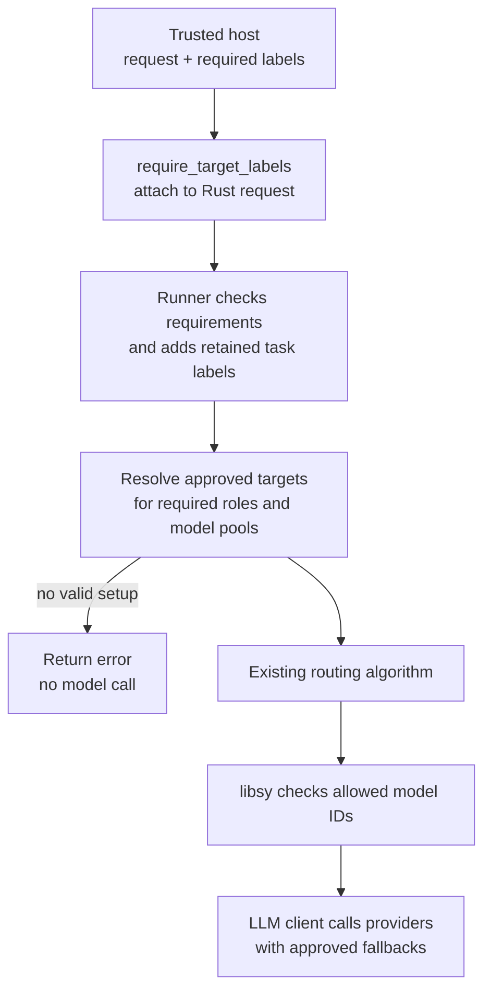

# Target eligibility in Switchyard

An application may know that a request contains customer records and must use
approved infrastructure. It passes the required labels to Switchyard. Switchyard
limits the available models, then runs the configured routing algorithm normally.
The application owns classification, authentication and endpoint approvals.

Switchyard does not classify the request. The trusted host supplies requirements
from its own policy or assessment.

## TOML and Rust API

Targets declare what they are approved to handle. A request supplies what it needs.
A target must carry **every** required label; extra target labels are allowed.
Label names have no built-in policy meaning.

The existing provider connections `cloud` and `approved` are omitted below.
Model IDs are examples.

```toml
[targets.efficient]
id = "standard-efficient-model"
llm_client = "cloud"

[targets.capable]
id = "standard-capable-model"
llm_client = "cloud"

[targets.approved_efficient]
id = "approved-efficient-model"
llm_client = "approved"
labels = ["private", "customer_data"]

[targets.approved_capable]
id = "approved-capable-model"
llm_client = "approved"
labels = ["private", "customer_data"]

[routes.coding]
id = "switchyard/coding"
type = "stage_router"
efficient_target = "efficient"
capable_target = "capable"
picker = "efficient_first"
confidence_threshold = 0.6

[routes.coding.eligibility]
require_explicit_requirements = false
scope = "request"

[routes.coding.eligibility.target_alternatives]
efficient = ["approved_efficient"]
capable = ["approved_capable"]
```

The new fields are:

- `targets.<name>.labels`: deployment approvals; default `[]`.
  `decision_targets.<name>.labels` does the same for typed decision targets.
- `routes.<name>.eligibility`: enables trusted requirements. A route without this
  table rejects supplied requirements, including an explicit empty collection.
- `require_explicit_requirements`: require a collection on every request. An empty
  collection counts; an absent one does not. Default: `false`.
- `scope`: `"request"` by default. `"task"` accumulates requirements under the
  host-authorized `request.metadata.task_id`.
- `target_alternatives`: ordered alternatives for existing target references;
  default `{}`. Its keys are configured target names, not role keywords. Here
  `efficient` refers to `[targets.efficient]`, which fills Stage's efficient role.

For each required role, Switchyard first tries its configured target. If that
target lacks a required label, it tries the listed alternatives in order. In this
example, `efficient` is tried before `approved_efficient`. Alternatives must
preserve target kind, and model IDs must remain unambiguous across provider
clients.

Alternatives select a target by approval labels; they are not a new retry list.
The routing algorithm keeps its existing answer fallback behavior.

The trusted Rust host attaches requirements after building the normalized request:

```rust
use switchyard_runner::require_target_labels;

let route = runner.route("switchyard/coding")
    .ok_or_else(|| anyhow::anyhow!("unknown route"))?;
require_target_labels(&mut request, ["private", "customer_data"])?;
let output = route.execute(request, None).await?;
```

The application passes labels, not a configured combination name. There is no
table of accepted combinations. Each combination works if the route can satisfy
all its requirements.

For the configuration above:

| Application requirements | Models offered to Stage |
| --- | --- |
| `[]` | Normal `efficient` and `capable`. |
| `["private"]` | Approved efficient and capable; both carry `private`. |
| `["private", "customer_data"]` | Approved efficient and capable; both carry both labels. |
| `["unapproved_requirement"]` | Error before any model call. |

To record an explicit empty collection, call the same helper:

```rust
require_target_labels(&mut request, std::iter::empty::<&str>())?;
```

Omitting the helper leaves the requirements absent. With the default optional
setting, absent and empty both permit normal routing. With
`require_explicit_requirements = true`, absence is rejected. In task scope,
neither absence nor an empty collection removes previously retained labels.

## Execution and crate responsibilities



Runner reads the TOML, validates alternatives and selects eligible targets before
execution. Candidate pools are filtered. Fixed roles, routing judges, typed
decisions, answer fallbacks and auxiliary calls must also qualify. A missing
required role stops the request; eligibility does not change the router's
selection rules.

Runner reuses provider clients. When requests resolve to the same target bindings,
they reuse the same algorithm setup and its state. The reuse key is the resolved
bindings, not the spelling of the supplied labels.

`TargetRequirements` holds the effective labels and their source; it does not
classify content or select a model. `EligibleLanes` resolves and reuses the
corresponding `ExecutionLane`. Earlier `EligibilityDecision` and `PrivacyDecision`
exports remain aliases for source compatibility.

Libsy runs the algorithm and rejects model IDs outside the permitted model groups.
The LLM client drives routing calls, ordered answer fallbacks and provider
transport. Translation keeps converting provider formats. The label rules belong
in Runner, not in provider codecs.

## Task requirements

Set `scope = "task"` and supply an authorized task ID to retain requirements across
requests. A later turn can add labels but cannot remove them. For example, a task
requiring `private` that later adds `customer_data` requires both from then on.
If the combined requirements cannot be served, the request fails.

Retention is bounded, in memory, and belongs to one route instance. There is no
reset, expiry, restart persistence or shared state across replicas. In-flight
requests keep their admitted requirements. The host must authorize task ownership.

A route retains at most 4,096 restricted tasks and 128 additional resolved model
setups. Requirements contain at most 64 labels of 128 bytes each. Exceeding a
limit returns an error; it does not clear requirements or evict routing state.

## Consumers and compatibility

An embedded Rust gateway or harness calls `require_target_labels` before executing
the route. It obtains labels from its own trusted policy or assessment. This core
API does not add a detector, model runtime or HTTP input. Runner-backed Python and
TypeScript bindings are separate additions; existing algorithm-only bindings do
not perform this admission check.
An integration that bypasses Runner does not acquire enforcement merely by
attaching metadata.

The existing binary helper remains a compatibility path: `true` adds `private`
and `false` adds no requirement. It is not the new calling convention. Old binary
TOML is rejected rather than silently interpreted as label configuration.
Existing execution APIs, provider formats and the Relay C ABI stay unchanged.

Optional semantic assessment is not part of this implementation. Earlier Pi, gateway and
model experiments are not evidence that a maintained label importer is available
for those consumers.

## Validation

Integration tests cover label matching, ordered alternatives, weighted pools,
task requirements, judges, auxiliary calls and approved answer fallbacks. Relay
tests cover buffered and streaming fallback calls with label configuration.
These suites use loopback provider fixtures; they do not measure classifier
quality or establish physical endpoint approvals.
