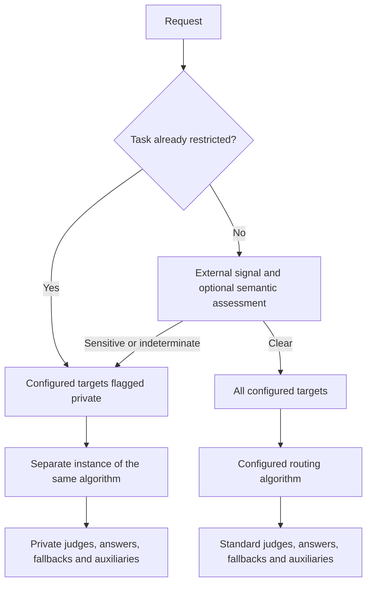

# Privacy routing spike

This spike lets an application restrict which configured targets Switchyard may call. It does
not add a routing algorithm. The target flag and configuration below are proposed, not released.

`private = true` means the deployment owner approves that target for restricted requests.
It does not detect sensitive content, verify the endpoint, or prevent a provider from retaining
data. Targets default to `private = false`.

## Target approval and an external signal

Declare the targets normally and flag the approved ones. The route lists its usual candidates;
there is no replacement-target map. Client definitions are omitted here.

```toml
[targets.fast]
id = "public-model"
llm_client = "public_endpoint"

[targets.internal]
id = "internal-model"
llm_client = "internal_endpoint"
private = true

[routes.coding]
id = "switchyard/coding"
type = "random"
targets = ["fast", "internal"]
weights = [3, 1]

[routes.coding.privacy]
accept_external_signal = true
```

The embedded application decides whether this request needs private targets:

```rust
use switchyard_runner::mark_privacy_restricted;

if requires_restricted_targets {
    mark_privacy_restricted(&mut request);
}
let output = route.execute(request, None).await?;
```

Unmarked requests use both configured candidates. Marked requests can use only `internal`,
including after a failed attempt. Random keeps the weights paired with their targets when
filtering. No detector or classifier runs in this example.

The signal is trusted, in-process Rust state, not an HTTP header or a Python binding. A marked
request fails if the route has not enabled external signals. An unmarked request can still be
restricted by an optional semantic check.



Filtering never imports another deployment's targets or silently changes a target's role.
Configurations fail to load if the remaining targets cannot support the chosen router.

Stage, Escalation and other fixed-role routers still need their required efficient, capable
and judge targets. A Stage route with a public efficient target and a private capable target
therefore cannot enable this policy: filtering would remove a required role. This spike does
not silently turn Stage into passthrough. Custom classifier pools can contain public and private
targets; their required groups must remain usable after filtering.

## Always-private workload

Use an ordinary route containing only approved targets. It does not need classification or a
second lane. Flag both targets `private = true`; Stage still makes its normal tier choice.

```toml
[targets.internal_fast]
id = "internal-small-model"
llm_client = "internal_endpoint"
private = true

[targets.internal_capable]
id = "internal-large-model"
llm_client = "internal_endpoint"
private = true

[routes.private_coding]
id = "switchyard/private-coding"
type = "stage_router"
efficient_target = "internal_fast"
capable_target = "internal_capable"
picker = "efficient_first"
confidence_threshold = 0.60
```

## Optional semantic assessment

Add one classifier to the mixed route. Generic LLM and typed decision models are alternatives,
not consecutive judges. Both require a target flagged `private = true`: the classifier receives
the content before deciding which targets may answer.

```toml
[targets.privacy_classifier]
id = "internal-classifier"
llm_client = "internal_endpoint"
private = true

[routes.coding.privacy.classifier]
type = "llm"
target = "privacy_classifier"
clear_threshold = 0.90
response_format_type = "json_schema"
# prompt = "Your policy instructions."
```

```toml
[decision_targets.privacy_decision]
id = "internal-decision-model"
decision_client = "internal_decisions"
private = true

[routes.coding.privacy.classifier]
type = "decision"
target = "privacy_decision"
clear_threshold = 0.90
# instructions = { policy = "Your policy instructions." }
```

The generic path supports `json_schema` and `json_object`, with typed local verdict validation.
Both include the schema in the prompt. Structural validation restricts opaque or oversized
content before classification; it does not detect PII. The input borrows content-bearing request
fields, including instructions, tools, extensions and preserved request bodies; it excludes transport
metadata and cached responses. Remote MCP tool definitions are not assessed, so their transport
credentials are not forwarded to the classifier. The serialized input is bounded to 64 KiB. Invalid output,
oversized input, uncertainty, low clear scores and failed calls restrict the current request.
`clear_score` is a model score, not a calibrated guarantee of safety.

The semantic adapter reuses libsy's private judge contract, request builder, decoder and
`Driver`. Built-in pattern detectors are not included. Ownership of privacy categories and
classifier prompts remains a team decision.

## Task retention

Set `restriction_scope = "task"` in the existing privacy table and supply
`request.metadata.task_id`. Only explicit external restriction or a valid sensitive semantic
verdict becomes sticky. A failure, invalid verdict, uncertainty or low clear score is reassessed
next turn.

Retention is process-local and limited to 4,096 restricted task IDs. There is no expiry, reset
API or replica coordination. Missing/invalid task IDs and exhausted capacity restrict requests.

## Responsibilities and API impact

| Component | Responsibility |
|---|---|
| Embedded application | Supply an external restriction and trusted task identity, if needed. |
| Libsy | Check allowed model IDs; build and validate optional semantic judge calls. |
| Runner | Filter configured targets, choose clients and auxiliaries, retain task restrictions. |
| LLM client | Execute provider requests, retries and candidate fallbacks. |

Direct Rust hosts can use `RuntimeModels::with_target_restriction()` and a matching
`ClientRouter`. The guard covers `Driver`, the default `run_stream`, and `drive`, including
rewritten steps from a custom stream. A custom stream consumer must enforce its own boundary.
Model IDs do not distinguish deployments exposing the same model: the host must select the
correct clients. This does not sandbox arbitrary Rust code or network calls made by the host.

The additive prototype APIs are `PrivacyPreflight`, `PrivacyAssessment`, and the restriction
builder. Existing public signatures and the native plugin ABI are unchanged. Runner adds direct
dependencies on existing workspace packages; no new package versions enter the lockfile.
Generic judge helpers remain private.

Target flags are internal configuration fields, not additions to public Rust types. There is
no `restricted_targets` or `restricted_decision_target` table. A typed routing judge and its
named candidates must be approved just like other callable targets. Aliases for the same
model on the same client cannot disagree on the flag.

Mixed routes currently reject forwarded caller auth, prefill routing and OpenAI Responses
continuation state. Direct embedded hosts must not reuse a broad client router's stored
continuation across privacy lanes. A private target's provider policy remains the deployment
owner's responsibility.

## Validation

Focused coverage checks target filtering, positional weights, required roles, classifier
approval, fallback enforcement and privacy marks on failed requests. Existing tests cover
bounded context, malformed verdicts, thresholds, task retention and cancellation. Synthetic
verdicts validate wiring, not classifier accuracy; no live provider benchmark was rerun for
this configuration change.

Classifier calls now use the standard libsy call spans and metrics. The INFO context span keeps
route attribution; Relay privacy decision marks are unchanged. Buffered response IDs/models
remain available. Abandoned calls use the existing `error` outcome rather than a separate
`cancelled` label. Custom prompts follow the shared contract, which rejects
`{{RESPONSE_SCHEMA}}` placeholders because Switchyard supplies the schema.
