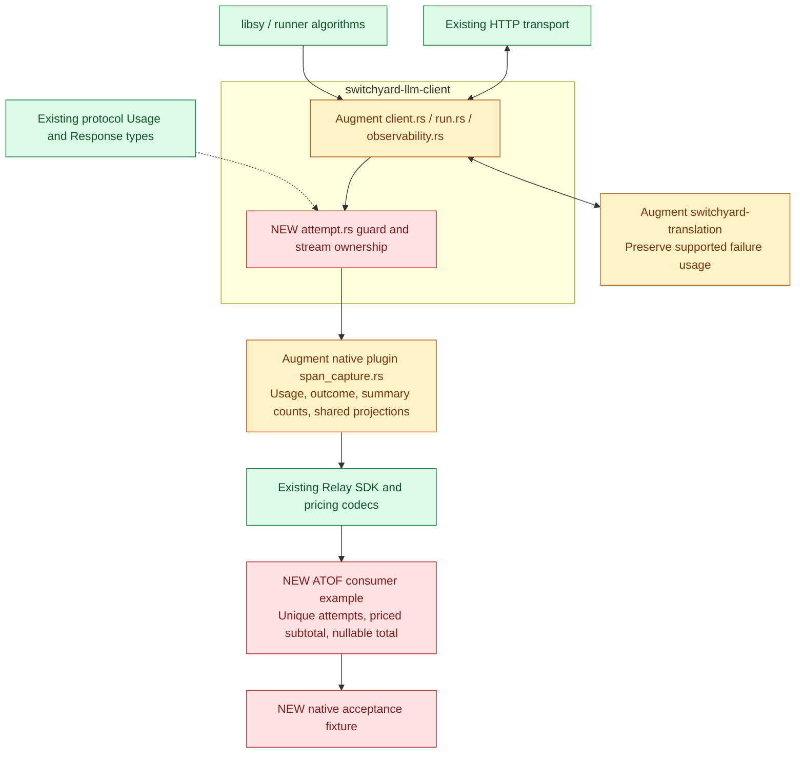

# Per-attempt accounting implementation

Implemented on `bbednarski/req3-attempt-accounting`, based on upstream main
`cf92c1135`. The changes are pending review and commit.

The client retains accounting until each dispatched completion attempt ends.
Its guard preserves usage across HTTP failures, decoding, routing buffering,
streaming errors, timeouts, and cancellation. Usage is cumulative by field.
Missing values remain unknown. Local failures before dispatch have no attempt.

The native plugin exports priceable attempt scopes, with content-free usage
and bounded error categories. Logical client calls become summary scopes with
expected and captured attempt counts. Existing payload capture remains optional
and supplements the accounting data.

## Scope

Three production crates change. The translation changes reuse provider usage
parsers and retain usage in Responses failed/incomplete terminal frames.
Protocol types, retry policy, and decision transports stay unchanged.

## Relay integration result

Tested a packaged macOS arm64 native bundle against `nemo-relay==0.10.0` and
native SDK `0.10.0`, with a loopback provider and fixed synthetic rates.

Generic native scopes retain their raw output, but do not acquire a normalized
pricing annotation automatically. Relay's outer answer also retains the final
response charge. The smallest follow-up is an opt-in ATOF consumer example that
selects unique attempt end events, decodes their output with Relay's existing
codec, and checks declared record coverage. It adds no price catalog or pricing
formula. No Relay source changes are required for this output.

Relay 0.10 ignores the scalar `usage.provider_cost` field. The plugin uses the
supported detailed `usage.cost` object so reported charges take precedence over
model-price estimates.

| Fixture | Known subtotal | Complete total |
| --- | --- | --- |
| Failed reported $0.02, successful reported $0.03 | $0.05 | $0.05 |
| Failed usage missing, successful reported $0.03 | $0.03 | Absent |
| Both attempts priced by configured token rates | $0.028 | $0.028 |
| Usage known, model price missing | $0 | Absent |
| Both attempts report $0, tokens missing | $0 | $0 |

The fixture also verifies duplicate-event delivery, missing attempt records,
reported-charge precedence over headers, and separation between workflows.
The Rust suites cover routing buffer failure, terminal stream errors, trailing
and repeated usage snapshots, timeout, abandonment, pre-dispatch deadlines,
concurrent requests, debug payload compatibility, and credential redaction.

## Validation and remaining boundaries

The full workspace Rust tests, formatting, and Clippy pass. The repository
pre-commit hooks pass. Optional non-blocking mypy/pyright commands are unavailable
in this environment; those hooks report that they did not execute.
The new Python scripts also pass a direct Ruff check and native acceptance.
See the plugin README for the reproducible native fixture command.

These totals cover observed instrumented completion attempts. Separate decision
calls remain Req 4. ATIF `final_metrics` is unchanged; use the supplied ATOF
summary for retry totals. Provider work continuing after disconnection, process
termination, and wholly absent telemetry cannot be reconciled from these records.
