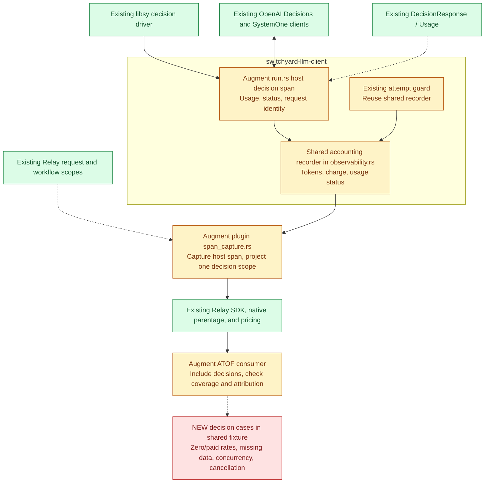

# Decision usage and workflow attribution implementation

Req 4 is implemented on `bbednarski/req4-decision-accounting`, based on Req 3
commit `8e00fd053`. Its ordinary upstream PR targets `main` and depends on #1221.
After #1221 merges, manually rebase or cherry-pick only the Req 4 commits onto
updated `main` so the PR comparison contains only Req 4. GitHub's managed stack
feature is not used.

The existing host `libsy.decision_client_call` span is the accounting source.
It records available `DecisionResponse.usage`, selected/response model, response
ID, safe outcome/error category, and selected request identity fields. The
native plugin projects it as one `libsy.decision_call` LLM scope with accounting
unit `decision_call`. Multiple questions in one invocation remain one record.

The core decision span and existing marks/metrics retain their diagnostic roles.
They are not additional charges. Decision transports, protocol types, completion
retry policy, and translation codecs have no Req 4 changes.

## Components

Green components are reused. Yellow components are augmented. Red components
are new code or test cases within existing modules.

Only two production crates change. `attempt.rs` delegates its existing usage
recording to the shared crate-private helper; its lifecycle and retry behavior
are unchanged. A small request-local context copies only session, task, turn,
and correlation IDs to the host decision span, excluding HTTP credentials and
arbitrary request metadata.

## Accounting and context boundary

The ATOF consumer prices unique completion-attempt and decision-call end events
with Relay's existing codec. It retains separate `attempts` and `decisions`
records, a known USD subtotal, and a nullable complete USD total. Missing usage,
missing price, explicit zero, and non-USD charges preserve their distinctions.

Completion coverage uses the Req 3 parent summaries. Decision coverage compares
accounting records with the existing unique `switchyard.routing.decision_call`
marks in the workflow. Marks establish expected record coverage; they are never
priced. Missing either a decision record or its coverage mark leaves the total
incomplete. No second decision export path is built from observations.

Native scope ancestry establishes workflow association. Header IDs supplement
that relationship and cannot substitute for it. Decisions without a known
workflow ancestor are reported as `unattributed_decisions`, are not assigned to
a guessed workflow, and prevent a complete total for the supplied event set.
Wholly missing telemetry cannot be detected or reconciled.

Relay's `scope_stack_active()` reports explicit stack ownership, not whether a
Python-synchronized native parent exists. The implementation does not use that
flag as evidence of attribution. Native acceptance asserts actual request and
workflow parent UUIDs. Concurrent logical workflows use separate Relay scope
stacks, including one workflow with no identity headers.

## Validation

A baseline test reproduced the gap: successful decision execution emitted a
completion span but no decision accounting span. It now passes with cache,
reasoning, total-token, model, and request-identity assertions.

Rust regressions cover both decision provider formats; missing/partial/zero
usage; reported zero charges; response-model fallback; HTTP/invalid-response
errors; host cancellation; multiple invocations and questions; and unchanged
observations and metric counts. Existing completion regressions remain in the
full workspace run.

The packaged native bundle was tested with Relay/SDK 0.10.0, a loopback provider,
and synthetic prices. The shared fixture retains all five Req 3 scenarios and
adds these decision checks:

| Scenario | Known subtotal | Complete total |
| --- | --- | --- |
| Answer $0.03 plus explicitly zero-priced decision | $0.03 | $0.03 |
| Answer $0.03 plus decision priced at $0.01 | $0.04 | $0.04 |
| Two paid decision/answer invocations in one workflow | $0.08 | $0.08 |
| Answer known, decision price or usage missing | $0.03 | Absent |
| Decision reports $0, tokens missing; answer $0.03 | $0.03 | $0.03 |
| Decision provider error | $0 | Absent |
| Two concurrent paid workflows | $0.04 each | $0.04 each |
| Cancellation during a native decision call | $0 | Absent |

The cancellation record retains the native request/workflow parent and reports
missing usage. Duplicate event delivery and missing decision records are also
checked. Native acceptance writes raw events, scenario reports, and environment
and bundle-digest metadata. Run it with `--include-decisions`; see the plugin
README for the command.

## Limits

ATIF `final_metrics` is unchanged. The verified combined workflow total is the
opt-in ATOF consumer output. Pricing remains Relay-owned and free decision models
require explicit zero rates. Errors without a usable `DecisionResponse` retain
missing usage; this change does not extract hidden charges from failed or invalid
decision provider bodies. Process termination and provider work after disconnect
can leave consumption unobserved.
