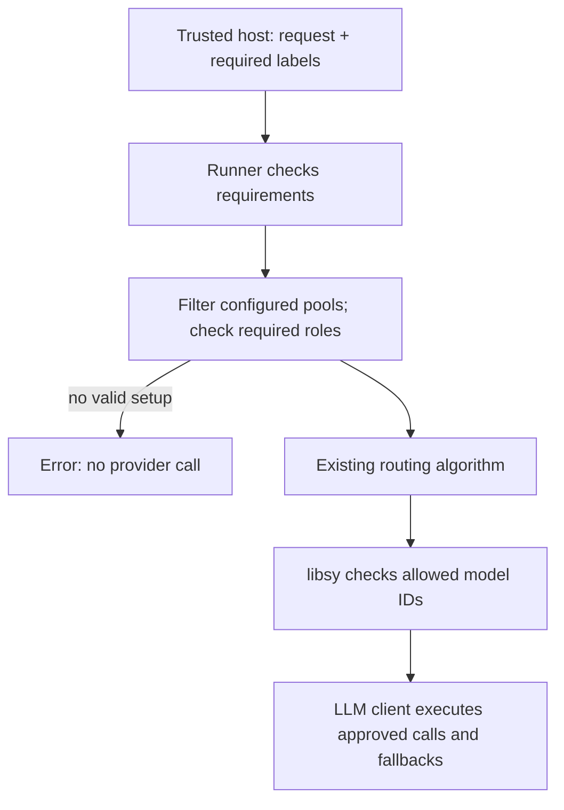

# Target eligibility in Switchyard

The trusted host supplies required labels. Switchyard limits the configured
models to approved targets, then runs the existing routing algorithm. The host
owns classification, authentication and endpoint approvals.

## Configuration

A target must carry every required label. Extra labels are fine, and label names
have no built-in meaning. Existing provider connections are omitted below.

```toml
[targets.public]
id = "cloud-model"
llm_client = "cloud"

[targets.approved_fast]
id = "approved-small-model"
llm_client = "approved"
labels = ["private", "customer_data"]

[targets.approved_capable]
id = "approved-large-model"
llm_client = "approved"
labels = ["private", "customer_data"]

[routes.assistant]
id = "switchyard/assistant"
type = "random"
targets = ["public", "approved_fast", "approved_capable"]

[routes.assistant.eligibility]
require_explicit_requirements = true
scope = "request"
```

- `targets.<name>.labels` declares approvals; default `[]`.
  `decision_targets.<name>.labels` does the same for typed decision targets.
- `eligibility` enables trusted requirements. A route without this table rejects
  supplied requirements, including an empty collection.
- `require_explicit_requirements` defaults to `false`. When `true`, every request
  needs a collection; an explicitly empty one counts.
- `scope` is `"request"`, the default and only supported value. Requirements
  cover this request and its internal model calls.

The example's unrestricted pool contains all three targets. Requiring `private`
keeps the two approved targets. Requiring both labels keeps the same two;
requiring an unsupported label fails before any provider call. There is no table
of accepted combinations.

Fixed-role routers keep their configured roles. Stage requires its efficient and
capable targets to qualify; a judge must qualify too. An unapproved required role
stops the request. This configuration does not search for replacement targets.

## Rust API

The host attaches labels to the normalized request, then executes the route:

```rust
use switchyard_runner::require_target_labels;

let route = runner.route("switchyard/assistant")
    .ok_or_else(|| anyhow::anyhow!("unknown route"))?;
require_target_labels(&mut request, ["private", "customer_data"])?;
let output = route.execute(request, None).await?;
```

An empty collection means the host assessed the request and found no requirements.
Omitting the helper supplies no assessment. With the default optional policy,
both allow normal routing. With `require_explicit_requirements = true`, omission
is rejected. Labels accumulate within one request but are not retained across
requests, even when they carry the same task ID.

## Execution



Runner owns label matching and reuses setups that keep the same configured
targets. Each setup keeps its algorithm, clients, model groups and auxiliary
targets together. Required judges, typed decisions, answer fallbacks and auxiliary
calls must qualify. Provider codecs keep their existing translation role.

A route caches at most 128 additional model setups. Requirements contain at most
64 labels of 128 bytes each. Limits fail closed; routing state is not evicted.
Provider-held Responses continuation state and forwarded caller authentication
are rejected on eligibility routes.

An integration must enter through Runner; attaching metadata to an algorithm-only
binding does not perform admission. This core adds no classifier, model runtime,
new HTTP input or provider format. Existing execution signatures and Relay's C
ABI stay unchanged.
