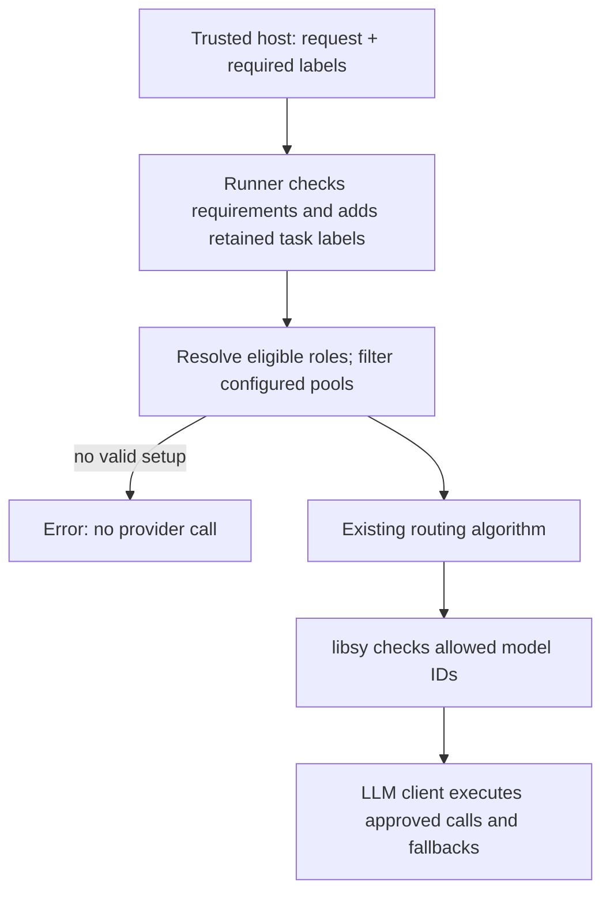

# Target eligibility in Switchyard

The trusted host supplies required labels. Switchyard limits the configured
models to approved targets, then runs the existing routing algorithm. The host
owns classification, authentication and endpoint approvals.

## Configuration

A target must carry every required label. Extra labels are fine, and label names
have no built-in meaning. Existing provider connections are omitted below.

```toml
[targets.fast]
id = "cloud-small-model"
llm_client = "cloud"

[targets.capable]
id = "cloud-large-model"
llm_client = "cloud"

[targets.approved_fast]
id = "approved-small-model"
llm_client = "approved"
labels = ["private", "customer_data"]

[targets.approved_capable]
id = "approved-large-model"
llm_client = "approved"
labels = ["private", "customer_data"]

[routes.assistant]
id = "switchyard/assistant"
type = "stage_router"
efficient_target = "fast"
capable_target = "capable"
picker = "efficient_first"
confidence_threshold = 0.6

[routes.assistant.eligibility]
require_explicit_requirements = true
scope = "request"

[routes.assistant.eligibility.target_alternatives]
fast = ["approved_fast"]
capable = ["approved_capable"]
```

- `targets.<name>.labels` declares approvals; default `[]`.
  `decision_targets.<name>.labels` does the same for typed decision targets.
- `eligibility` enables trusted requirements. A route without this table rejects
  supplied requirements, including an empty collection.
- `require_explicit_requirements` defaults to `false`. When `true`, every request
  needs a collection; an explicitly empty one counts.
- `scope` defaults to `"request"`. Requirements cover this request and its
  internal model calls. `"task"` also retains labels under the host-authorized
  `request.metadata.task_id`.
- `target_alternatives` maps configured target names to ordered alternatives;
  default `{}`. Keys name targets, not router roles. Alternatives must preserve
  target kind.

Switchyard prefers the original target when it carries every required label.
Otherwise, it uses the first listed alternative that qualifies. Resolution is
one step: it does not follow another target's alternatives. If no eligible target
can fill a required role, the request fails before any provider call.

In the example, empty requirements keep `fast` and `capable`. Requiring `private`
selects `approved_fast` and `approved_capable`. Requiring both labels selects the
same two; requiring an unsupported label fails closed. There is no table of
accepted combinations. Model pools are filtered by the same label requirements.

Stage's efficient and capable roles remain distinct, and any configured judge
must also qualify. Alternatives resolve approvals before execution; they are not
a runtime fallback list. The algorithm keeps its existing answer fallback rules.

## Rust API

The host attaches labels to the normalized request, then executes the route:

```rust
use switchyard_runner::require_target_labels;

let route = runner.route("switchyard/assistant")
    .ok_or_else(|| anyhow::anyhow!("unknown route"))?;
require_target_labels(&mut request, ["private", "customer_data"])?;
let output = route.execute(request, None).await?;
```

An empty collection means the host assessed the request and found no requirements.
Omitting the helper supplies no assessment. With request scope and the default
optional policy, both allow normal routing. With
`require_explicit_requirements = true`, omission is rejected. With request scope,
labels accumulate within one request but are not retained across requests, even
when they carry the same task ID.

## Task requirements

Set `scope = "task"` to retain requirements across requests. Every request needs
a trusted `request.metadata.task_id`: a nonempty string of at most 512 bytes,
without surrounding whitespace. The host must authorize task ownership.

Labels only accumulate for the same task ID; different IDs are independent.
For example, a task requiring `private` that later adds `customer_data` requires
both from then on. Missing or empty requirements do not remove retained labels.
If the combined requirements cannot be served, the request fails and the labels
remain retained.

State is in memory and belongs to one route instance. There is no reset, expiry,
replication, restart persistence or revocation. Overlapping in-flight requests
keep the requirements under which they were admitted.

## Execution



Runner owns label matching and reuses setups that resolve to the same configured
targets. Each setup keeps its algorithm, clients, model groups and auxiliary
targets together. Required judges, typed decisions, answer fallbacks and auxiliary
calls must qualify. Provider codecs keep their existing translation role.

A route retains at most 4,096 restricted tasks and caches at most 128 additional
model setups. Requirements contain at most 64 labels of 128 bytes each, including
the combined labels retained for a task. Limits fail closed; requirements are not
cleared and routing state is not evicted.
Provider-held Responses continuation state and forwarded caller authentication
are rejected on eligibility routes.

An integration must enter through Runner; attaching metadata to an algorithm-only
binding does not perform admission. This core adds no classifier, model runtime,
new HTTP input or provider format. Existing execution signatures and Relay's C
ABI stay unchanged.
