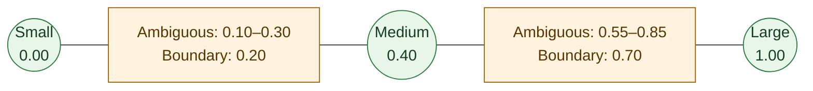

# N-target pools and FallThrough

A target pool maps a normalized score to one of N ordered models. This is shared
FallThrough infrastructure: classifiers evaluate a request, while the pool owns
the final score-to-target mapping. Adding another model does not require a new
cascade or a new branch in every score-based classifier.

**Stage is the current score-pool integration.** TOML exposes the pool on
`stage_router` routes and on the Stage component of `composite` routes. Other
route types do not automatically gain a pool setting. Rust integrations can
attach a pool with `RuntimeModels::with_pool(pool)?` and use compatible
classifiers in FallThrough. Existing custom-schema LLM routing already supports
multiple categorical targets independently of this score-pool feature.

## Score, confidence, and ambiguity

| Output | Meaning | Resolution |
|---|---|---|
| `ClassifierOutput::Position` | A score position in `[0,1]`, a separate confidence in `[0,1]`, and an explicit ambiguity flag. | Clear positions map to the nearest pool anchor. Ambiguous positions continue the cascade. |
| `ClassifierOutput::Decision` | An existing `Classification` containing target IDs, confidences, and optional categories. | Clear target decisions pass through directly. Ambiguous decisions continue the cascade. |

A position describes where the request belongs on the configured line; confidence
describes certainty. A high position is not inherently high confidence, and the
position is not required to be a probability. The classifier decides whether its
result is ambiguous. Confidence alone does not stop the cascade. Stage uses the
pool's geometry helpers to calculate its ambiguity bands; another classifier must
make its own ambiguity policy explicit.

`Classifier::classify` defaults to the existing `Classifier::score` method. Existing
`Score.target`, `Classification`, and `Classifier::score` remain supported. Fixed
target decisions, category-based failover, request mutations, and served-response
reuse remain available. An explicit target must belong to the runtime completion
group; it need not be an anchor in a smaller optional pool.

## Anchors and bands

Configure ordered target anchors from `0` to `1`. Omitted positions are evenly
spaced. N targets have N anchors, N−2 interior anchors, and N−1 adjacent intervals.
For adjacent anchors `a` and `b`, the boundary is `(a+b)/2`. Stage's closed
ambiguity band extends `t * (b-a)/2` on either side of that boundary, where `t` is
its confidence threshold.

For anchors `[0.0, 0.4, 1.0]` and `t=0.5`, the two bands differ in width because
the anchor intervals differ. The diagram labels the exact values; spacing is
schematic.

| Score position | Stage result at `t=0.5` |
|---|---|
| `[0.00, 0.10)` | Clear → small |
| `[0.10, 0.30]` | Ambiguous → next classifier |
| `(0.30, 0.55)` | Clear → medium |
| `[0.55, 0.85]` | Ambiguous → next classifier |
| `(0.85, 1.00]` | Clear → large |

At `t=0`, only exact boundaries are ambiguous. At `t=1`, all continuous positions
are ambiguous, including uneven anchors; rounding cannot open a gap. Categorical
target decisions remain clear at any threshold. If another classifier explicitly
marks an exact-boundary position clear, pool resolution breaks the tie toward the
lower anchor.

### Two targets keep their routing behavior

This expands the existing two-target routing model. Without a pool, valid binary
configurations keep their decision path. With anchors `[0,1]`, the midpoint is
`0.5` and the closed ambiguity band is `[0.5-t/2, 0.5+t/2]`, exactly the existing
Stage formula. The binary judge, overrides, holds, prompts, and terminal fallback
remain in place. N-target routing is optional.

Validation is stricter for invalid inputs: non-finite or out-of-range confidence
now errors for both clear and ambiguous verdicts. Numeric outputs require a pool
even when ambiguous. These checks do not change valid two-target selections.

## Cascade branches

Pool/classifier compatibility is checked before any processor or classifier call.
Processors then prepare the request, and classifiers run in order until the first
clear result. Ambiguous classifiers do not resolve targets. Only the accepted
numeric result reaches the pool resolver; direct target decisions bypass it.

| Branch | Expected outcome |
|---|---|
| Pool exceeds a classifier's declared target limit | Error before any processor or classifier runs, even if an earlier classifier could decide. |
| Clear target decision | Use its target directly; stop the cascade. Highest confidence wins within the verdict; ties keep the first. |
| Clear numeric position | Resolve once through the pool to the nearest anchor; stop the cascade. |
| Ambiguous verdict or empty target recommendations | Continue to the next classifier. |
| Every classifier abstains | Generic FallThrough errors. Stage supplies a terminal fallback to its picker endpoint. |
| Deciding classifier already produced a response | Reuse that response without another answer call. |
| Abstaining classifier produced a response | Warn, discard the response, and continue. |
| Numeric output without a pool, or invalid score/confidence | Error, including when the verdict is ambiguous. |
| Selected target is absent from runtime completion targets | Error before an answer call. |
| Classifier or processor returns an error | Propagate it unless an existing recovery policy handles it. |
| Selected upstream fails | Existing execution/failover policy applies. Target decisions retain category-based fallback ordering. |

Decision processors observe the final selection and can apply prompts or update
state. Request edits remain visible to later classifiers and to the selected
model. The optional parent pool does not leak into subagent routing.

## How Stage uses the pool today

See the [Stage configuration example](stage_router_routing.md#optional-more-than-two-targets).
The first pool target must match `efficient_target`; the last must match
`capable_target`. In a Composite route, use `[routes.agent.stage.pool]`.

| Stage branch | Expected outcome |
|---|---|
| An endpoint hold is active | Select that endpoint; skip signal classification and the fallback judge. |
| No active hold; hard recovery override | Select the capable endpoint. |
| No override; tool signals available | Emit a position and use the configured bands to declare it clear or ambiguous. |
| Signals are ambiguous or absent | Consult the optional fallback judge, then use the picker endpoint if it abstains. |
| N > 2 and an LLM fallback is configured | Generate N categories using the existing custom-schema classifier; a valid verdict selects a target directly. |
| Invalid judge reply | Existing warning/recovery behavior applies; a missing verdict reaches the picker fallback. |
| An intermediate model is selected | No endpoint hold or endpoint prompt applies. A later move to an endpoint counts as a switch for its hold. |

Efficient-first falls open to the first endpoint; capable-first to the last.
Composite's outer judge still selects an EF/CF **policy**, while Stage selects
the model. Binary judge settings remain available when the pool is omitted or
contains two targets. N-target fallback rejects incompatible binary settings
rather than silently ignoring them.

## Compatibility and validation

| Classifier or component | N-target pool support |
|---|---|
| Stage signals | Numeric positions across the configured line. |
| Categorical custom-schema LLM, random selection, affinity, fixed-target fallback | Can return direct decisions among available targets. |
| Capability, decision, escalation, VGR model-selection classifiers | Binary; declare a maximum of two pool targets. |
| Composite's outer EF/CF judge | Allowed: selects the routing policy, not a model from the pool. |
| Advisor | Direct-response behavior is unchanged. |
| User-defined classifier | Can declare `max_pool_targets`; an undeclared limit is not proof of N-target correctness. |

Construction validates target names, distinct pool targets, anchor count/order,
finite positions, endpoints, thresholds, holds, and judge contracts. Attaching a
pool validates membership in the parent's completion group. Stage rejects
conflicting judges, unsupported retention settings, invalid schemas/selectors,
empty prompts, and zero judge token limits. The cascade checks every declared
classifier limit against the runtime pool before any calls; it cannot discover an
undeclared restriction inside a custom classifier.

Info logs report pool/fallback setup, score/threshold/ambiguity, and the final
target, classifier index, output kind, and response reuse. Debug logs show cascade
continuation. Discarded responses from abstaining classifiers and unavailable
judge verdicts generate warnings. These events omit prompts and tool outputs.
