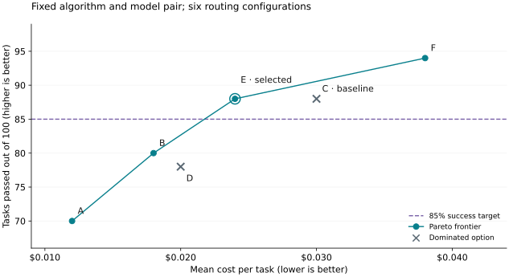
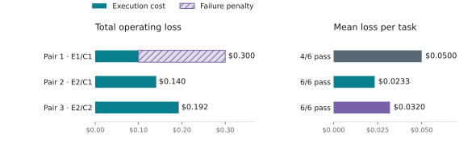

# Examples of tuning

These two comparisons show how to choose routing settings or a model pair for
a fixed objective. Start with [Tuning Foundations](foundations.md) to define
that objective and design candidates. All numbers are illustrative, not measured
benchmark results. The final section outlines planned GEPA support.

## Tune configuration options for cost

Suppose the goal is to **minimize mean cost per task while passing at least 85%
of tasks**. Keep the routing algorithm and model pair fixed. Change only the
routing threshold and how long the router stays on the capable model.

Use `stage_router` with `picker = "efficient_first"`, no classifier,
`recent_turn_window = 5`, and `efficient_hold_turns = 0`. Keep the model pair,
serving settings, agent, task limits, initial cache setup, and all other options
fixed. Compare all six candidates on the same 100 validation tasks, with a
separate test set reserved for the final choice.

Vary `confidence_threshold` and `capable_hold_turns`. A lower threshold lets
weaker signals trigger escalation; a hold keeps requests on the capable tier
after switching. See the [threshold guide](../routing_algorithms/stage_router_routing.md#tuning-confidence_threshold)
for details. Run each candidate end to end: changed routing can alter later
prompts, cache state, and costs, so reusing one run's outcomes can misrank them.

Here are results from one run per validation task, with C as the baseline.
Compare mean cost among candidates meeting the 85% target. Include failed tasks,
retries, and cache charges in that cost.

| Candidate | Threshold | Hold (requests) | Tasks passed | Mean cost per task |
|---|---|---|---|---|
| A | 0.7 | 0 | 70/100 | $0.012 |
| B | 0.5 | 0 | 80/100 | $0.018 |
| C (baseline) | 0.3 | 0 | 88/100 | $0.030 |
| D | 0.7 | 2 | 78/100 | $0.020 |
| E | 0.5 | 2 | 88/100 | $0.024 |
| F | 0.3 | 2 | 94/100 | $0.038 |

E improves on C: it passes the same number of tasks and costs less. B improves
on D in both cost and task success. Remove C and D from consideration.

**A, B, E, and F form the Pareto frontier.** No other tested candidate matches or
improves both measures while improving at least one. These options offer the
remaining cost/success tradeoffs:

*Figure 1. The circles form the observed Pareto frontier. Crosses mark candidates
that another option improves on. The dashed line is the 85% task-success target.*

**Select E under this objective.** A and B miss the success target. E and F both
meet it, but E costs less: $0.024 per task, or $2.40 across 100 tasks. E reduces
cost by 20% from baseline C while preserving its observed 88% success rate.
F buys a higher success rate at a higher cost.

The frontier describes this sample. Repeat promising runs, then freeze the
selection and evaluate it on untouched test tasks.

## Model-pair selection with fixed algorithm settings

This independent example fixes the algorithm settings and changes the
efficient/capable model pair. Score each task as **execution cost plus $0.10 if
it fails**, then minimize the mean score. Choose that penalty before comparing
results; it expresses how much failure matters for this example.

Use `stage_router` with `picker = "efficient_first"`, `confidence_threshold = 0.5`,
`recent_turn_window = 5`, `capable_hold_turns = 2`, `efficient_hold_turns = 0`, and
no classifier. Keep all other settings and evaluation conditions fixed. Check
[model compatibility](../routing_algorithms/model_selection.md) before running.

The fictional pairs below run on the same six validation tasks. Pair 2 changes
only the efficient model from Pair 1; Pair 3 changes only the capable model from
Pair 2. Run each pair end to end, since model outputs affect later routing.

| Pair | Efficient / capable | Tasks passed | Total execution cost | Failure penalty | Mean loss per task |
|---|---|---|---|---|---|
| 1 | E1 / C1 | 4/6 | $0.100 | $0.200 | $0.0500 |
| 2 | E2 / C1 | 6/6 | $0.140 | $0.000 | $0.0233 |
| 3 | E2 / C2 | 6/6 | $0.192 | $0.000 | $0.0320 |

Include every billed call, retry, and cache charge. For Pair 1, add $0.100 in
execution costs and $0.200 for two failures, then divide by six tasks: $0.0500
per task. Failure penalties are part of the score, not billed charges.

*Figure 2. Model-pair comparison under fixed algorithm settings.*

**Select Pair 2.** Pair 1 has the lowest billed cost but loses its advantage when
failures count. Pair 3 costs more without improving success on this sample.
Repeat the comparison on representative tasks before making a deployment choice;
follow the [final validation guidance](foundations.md#4-check-the-final-choice).

## Upcoming: GEPA tuning for the unified router

GEPA-based prompt tuning for the unified router is planned for a future release,
with tooling and concrete APIs to run the workflow. GEPA proposes instruction
changes from feedback, evaluates them, and repeats while model weights stay
fixed. See the [GEPA paper](https://arxiv.org/abs/2507.19457) for the approach.

The planned example will keep the model pool and objective fixed while changing
the router's instructions:

- Use training-task outcomes to show where routing choices helped or hurt the
  objective. A reflector model uses that feedback to propose revised instructions.
- Compare proposed prompts on validation tasks using the same cost and success
  measures, including the cost of routing calls.
- Freeze the chosen prompt and evaluate it on separate test tasks.

The API walkthrough and worked results will accompany the tooling release.
