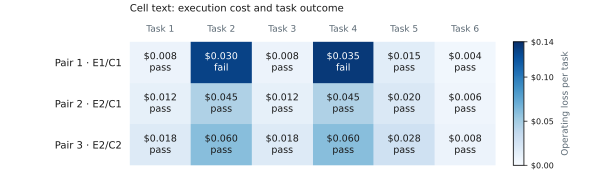

# 5. Examples of tuning

Use these examples after defining an objective and candidate configurations in
[Tuning Foundations](foundations.md). Each comparison holds the objective fixed
while changing one part of the system. All numbers below are invented to make
the calculations easy to follow; they are not benchmark results.

## 5.a. Tune configuration options for cost

Suppose the goal is to **minimize mean cost per task while passing at least 85%
of tasks**. Keep the routing algorithm and model pair fixed. Change only the
routing threshold and how long the router stays on the capable model.

For candidates that meet the success target, the loss is mean cost per task.
Candidates below 85% do not qualify. Include the cost of every task, including
failed tasks and retries.

### Set up the comparison

Use a representative subset of benchmark tasks to develop the candidates, then
compare them on the same 100 validation tasks. Reserve a separate test set for
the final choice, as described in [Check the final choice](foundations.md#4-check-the-final-choice).

Keep these settings fixed:

- **Algorithm:** `stage_router`, with `picker = "efficient_first"` and no optional
  classifier.
- **Models:** the same efficient/capable pair, with model versions, providers,
  and serving settings pinned.
- **Other settings:** `recent_turn_window = 5`, `efficient_hold_turns = 0`, and
  all other routing options.
- **Evaluation:** the same agent instructions, tools, task limits, cache setup,
  and number of trials for every candidate.

Try `confidence_threshold` values of `0.3`, `0.5`, and `0.7`, each with
`capable_hold_turns` set to `0` or `2` requests. This gives six configurations.
A lower threshold lets weaker signals
trigger escalation; a hold keeps requests on the capable tier after a switch.
Their cost and success effects depend on the workload. See the
[stage-router threshold guide](../routing_algorithms/stage_router_routing.md#tuning-confidence_threshold)
for the exact behavior.

### Compare the results

Here are illustrative results from one run per validation task. Configuration C
is the baseline in this example. Mean cost includes all 100 tasks.

| Candidate | Threshold | Hold (requests) | Tasks passed | Mean cost per task |
|---|---|---|---|---|
| A | 0.7 | 0 | 70/100 | $0.012 |
| B | 0.5 | 0 | 80/100 | $0.018 |
| C (baseline) | 0.3 | 0 | 88/100 | $0.030 |
| D | 0.7 | 2 | 78/100 | $0.020 |
| E | 0.5 | 2 | 88/100 | $0.024 |
| F | 0.3 | 2 | 94/100 | $0.038 |

First remove options that another candidate matches or improves on both measures:

- **Remove C:** E passes the same number of tasks (88) and costs less on average.
- **Remove D:** B passes more tasks and costs less on average.
- **Keep A, B, E, and F:** each offers a cost/success tradeoff. No other tested
  candidate costs the same or less and passes the same number or more, with an
  improvement in at least one measure.

These remaining options form the **Pareto frontier** for this sample. It is a
shortlist of tradeoffs, not a single winner. Plot cost horizontally and task
success vertically to see which options are worth considering.


*Figure 1. The circles form the observed Pareto frontier. Crosses mark candidates
that another option improves on. The dashed line is the 85% task-success target.*

**Select E under this objective.** A and B miss the success target. E and F both
meet it, but E costs less: $0.024 per task, or $2.40 across 100 tasks. E reduces
cost by 20% from baseline C while preserving its observed 88% success rate.
F buys a higher success rate at a higher cost.

This frontier covers only the configurations tested on this sample. Repeat
promising runs to check whether differences hold up, then freeze the selected
configuration and evaluate it on the untouched test tasks. New measurements can
change which options belong on the frontier.

## 5.b. Model-pair selection with fixed algorithm settings

In this example, each candidate uses the same routing algorithm and settings but
assigns different models to the efficient and capable tiers. The question is
which model pair best supports the objective under that fixed routing policy.

**What changes:** the efficient/capable model pair. **What is scored:** mean
operating loss across all evaluated tasks, including failures.

### Define the experiment

Keep the following conditions fixed:

- **Algorithm:** `stage_router`, with `picker = "efficient_first"`.
- **Routing settings:** `confidence_threshold = 0.5`, `recent_turn_window = 5`,
  `capable_hold_turns = 2`, and `efficient_hold_turns = 0`; no optional classifier.
- **Evaluation:** the same six tasks, agent instructions, tools, per-task limits,
  cache setup procedure, and number of trials. Pin each model's version and
  serving configuration. Keep all other algorithm settings fixed.
- **Objective:** minimize mean execution cost plus a **$0.10 penalty per failed
  task**. Count all billed model calls, including retries and cache charges.

Test three candidate pairs. The model IDs below are fictional:

- **Pair 1:** efficient model **E1**, capable model **C1**.
- **Pair 2:** efficient model **E2**, capable model **C1**. Relative to Pair 1,
  this changes only the efficient model.
- **Pair 3:** efficient model **E2**, capable model **C2**. Relative to Pair 2,
  this changes only the capable model.

Run each pair on the full task set. Fixed algorithm settings do not imply the
same routing decisions: changing a model can change its outputs, tool results,
and the later routing signals. Measure each pair's complete runs, including
these effects. See [Choose Models](../routing_algorithms/model_selection.md) for
compatibility checks before running the comparison.

### Measure outcomes and calculate loss

The following task costs and pass/fail outcomes are dummy data. They illustrate
the experiment and are not results for real models.




*Figure 2. Execution cost and task outcomes for three model pairs under the same
algorithm settings. Failure penalties contribute to the objective but are not
billed execution costs.*

For every task, add its execution cost and the failure penalty, if any. Average
these task losses to score the pair:

- **Pair 1:** total execution cost is **$0.100** and **4 of 6** tasks pass. Two
  failures add **$0.200**, giving **$0.300** total operating loss, or **$0.0500 per
  task**.
- **Pair 2:** total execution cost is **$0.140** and **6 of 6** tasks pass. No
  failure penalty applies, giving **$0.140** total operating loss, or **$0.0233 per
  task**.
- **Pair 3:** total execution cost is **$0.192** and **6 of 6** tasks pass. No
  failure penalty applies, giving **$0.192** total operating loss, or **$0.0320 per
  task**.

For example, on task 2, Pair 1 costs $0.030 and fails, so its operating loss is
**$0.130**. Pair 2 costs $0.045 and passes, so its operating loss is **$0.045**.
The higher execution cost is justified under the chosen failure penalty.

**Select Pair 2 under this objective.** Pair 1 has the lowest billed cost but the
highest operating loss once failures are counted. Pair 3 costs more than Pair 2
without improving task success on this sample. The algorithm settings stayed
fixed throughout; the model pair changed.

Here, the loss combines cost and failed tasks using the penalty chosen before
the experiment. Repeat the comparison on representative tasks and independent
trials before drawing conclusions about real model pairs.

## 5.c. Upcoming: GEPA tuning for the unified router

GEPA-based prompt tuning for the unified router is planned for a future release,
with tooling and concrete APIs to run the workflow. GEPA proposes instruction
changes from feedback, evaluates them, and repeats while model weights stay
fixed. See the [GEPA paper](https://arxiv.org/abs/2507.19457) for the approach.

The planned example will keep the model pool and objective fixed while changing
the router's instructions:

- Use training-task outcomes to show where routing choices helped or hurt the
  objective. A reflector model uses that feedback to propose revised instructions.
- Compare proposed prompts on validation tasks using the same cost and success
  measures, including the cost of routing calls.
- Freeze the chosen prompt and evaluate it on separate test tasks.

The API walkthrough and worked results will accompany the tooling release.

## Reproduce the calculations

Save the following as `tuning_examples.py` and run `python3 tuning_examples.py`.
It uses only the Python 3 standard library and the dummy data above. It calculates
the Pareto frontier and selected configuration for 5.a, then the operating losses
for 5.b. It makes no model calls.

```python
# Candidate: (threshold, capable hold, mean cost, tasks passed out of 100).
configs = {
    "A": (0.7, 0, 0.012, 70),
    "B": (0.5, 0, 0.018, 80),
    "C": (0.3, 0, 0.030, 88),
    "D": (0.7, 2, 0.020, 78),
    "E": (0.5, 2, 0.024, 88),
    "F": (0.3, 2, 0.038, 94),
}

frontier = []
for name, (_, _, cost, passed) in configs.items():
    dominated = any(
        other_cost <= cost and other_passed >= passed
        and (other_cost < cost or other_passed > passed)
        for _, _, other_cost, other_passed in configs.values()
    )
    if not dominated:
        frontier.append(name)

eligible = [name for name in frontier if configs[name][3] >= 85]
selected = min(eligible, key=lambda name: configs[name][2])
print("Pareto frontier:", ", ".join(frontier))
print(f"Selected config: {selected}, mean cost=${configs[selected][2]:.3f}")

# Independent model-pair experiment: (execution cost, task passed), tasks 1–6.
failure_penalty = 0.10
pairs = {
    "Pair 1 (E1/C1)": [
        (0.008, True), (0.030, False), (0.008, True),
        (0.035, False), (0.015, True), (0.004, True),
    ],
    "Pair 2 (E2/C1)": [
        (0.012, True), (0.045, True), (0.012, True),
        (0.045, True), (0.020, True), (0.006, True),
    ],
    "Pair 3 (E2/C2)": [
        (0.018, True), (0.060, True), (0.018, True),
        (0.060, True), (0.028, True), (0.008, True),
    ],
}

pair_losses = {}
for name, results in pairs.items():
    cost = sum(cost for cost, passed in results)
    failures = sum(not passed for cost, passed in results)
    total = cost + failure_penalty * failures
    pair_losses[name] = total / len(results)
    print(f"{name}: cost=${cost:.3f}, failures={failures}, "
          f"total=${total:.3f}, mean=${pair_losses[name]:.4f}")
print("Selected:", min(pair_losses, key=pair_losses.get))
```

Expected output:

```text
Pareto frontier: A, B, E, F
Selected config: E, mean cost=$0.024
Pair 1 (E1/C1): cost=$0.100, failures=2, total=$0.300, mean=$0.0500
Pair 2 (E2/C1): cost=$0.140, failures=0, total=$0.140, mean=$0.0233
Pair 3 (E2/C2): cost=$0.192, failures=0, total=$0.192, mean=$0.0320
Selected: Pair 2 (E2/C1)
```

Before using the selected configuration, [check the final choice](foundations.md#4-check-the-final-choice).
Return to [Compare and Tune](index.md) to run and record the routing experiment.
