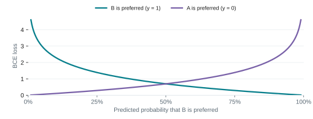
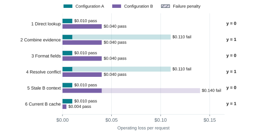
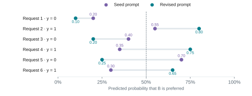
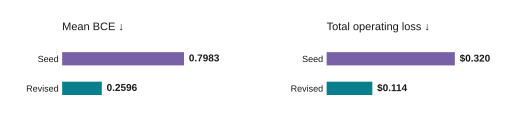
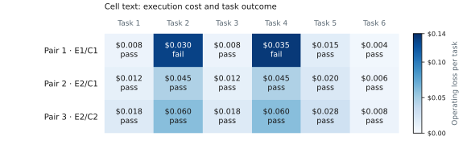
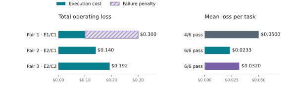

# Tuning Foundations

Configuration settings describe how the system behaves. The user's objective
describes what that behavior should achieve. This guide bridges the gap between
the two: define a measurable objective, design candidate configurations, and use
a loss function to compare them against that fixed objective.

The objective determines what counts as better. The configurations define the
alternatives we can test. The loss connects the two by assigning a score to each
candidate's results. For the steps to run a routing experiment, start with
[Compare and Tune](index.md).

For a quick walkthrough with concrete data, jump to
[Section 4: Examples of tuning](#4-examples-of-tuning).

## 1. Define the objective

Start with the outcome the user wants. Define what to measure, on which workload,
and what makes a result acceptable. Keep this definition fixed while comparing
candidates, whether the experiment contains two configurations or many.

- **Reduce cost while preserving accuracy.** Minimize total cost per task while
  meeting a defined accuracy requirement. Include decision calls, retries, and
  cache charges in the cost.
- **Maximize task success.** Maximize the fraction of tasks completed correctly,
  subject to any cost or latency limits.
- **Reach a desired routing split.** Target a defined allocation across the
  configured targets. This could be 70% of calls on the efficient tier and 30% on
  the capable tier, or a distribution across three or more targets. Specify the
  counting unit, allowed deviation, and quality requirement.
- **Reach a capable-tier cache-usage target.** Target a specified percentage of
  capable-tier input tokens served from cache, such as at least 80%. Measure
  cache-read input tokens divided by all input tokens on capable-tier calls over
  the evaluation workload. Specify the target percentage and any quality
  requirement before comparing candidates.

Once the objective is measurable, the next step is to choose configurations that
might achieve it. This separates the outcome we want from the settings we will
test.

## 2. Design configuration candidates

A candidate is a complete configuration to evaluate under the fixed objective.
The candidate set can contain any number of alternatives. Give each a distinct
ID, such as A, B, and C, and compare all of them using the same objective and
evaluation procedure.

The objective describes what success means; candidate design determines which
possible solutions the experiment will consider. A loss can rank the candidates
we test, but it cannot find an improvement that none of them can produce.

Build the candidate set in these steps:

1. **Choose a baseline.** Record the current configuration and its measured
   outcomes. Include it in the comparison so improvements have a reference point.
2. **State a reason for each change.** Connect the proposed behavior to the
   objective. For example, staying on one model longer might preserve cached
   context and reduce cost. Test both the cost effect and the quality effect.
3. **Choose what can vary.** This could be model targets, routing policy,
   thresholds, hold durations, or decision instructions. Specify the allowed
   values and hold other settings fixed. Start with a small set that can answer
   the question behind the experiment.
4. **Include combinations when settings interact.** A threshold and a hold
   duration can affect the same routing decisions. After a small initial
   comparison, test selected combinations rather than assuming their individual
   effects will add up.
5. **Make candidates reproducible and comparable.** Give each one an ID and save
   its full configuration. Use the same workload and evaluation procedure, pin
   model and provider versions where possible, and apply the same cache setup
   procedure. Let each candidate's behavior determine subsequent cache usage.

For example, suppose the objective is lower cost while maintaining the specified
task-success floor. One small stage-router experiment could be:

- **Baseline:** `confidence_threshold = 0.5` and `capable_hold_turns = 2`.
- **Initial candidates:** thresholds `0.3`, `0.5`, and `0.7`, all with a capable
  hold of `2` turns. This gives three candidates, including the baseline.
- **Interaction check:** add a hold duration of `0` for each threshold. The full
  set now has six candidates, not six plus the baseline.
- **Fixed conditions:** the model pair, picker, classifier configuration, other
  routing settings, and evaluation workload. Compare task success and total cost
  for every candidate, then rank those that meet the success floor.

These values illustrate candidate design, not recommended settings. The effect
of a threshold depends on the picker, classifier, and other routing rules. Follow
the [stage-router threshold guide](../routing_algorithms/stage_router_routing.md#tuning-confidence_threshold)
when choosing values. See
[model selection](../routing_algorithms/model_selection.md#counter-examples) for
cases where switching lost cache savings.

Keep the objective fixed throughout the comparison. A candidate that improves
cost but misses the quality requirement is ineligible under that objective.
Changing the requirement creates a different comparison.

With the objective and candidates fixed, we can measure their outcomes and
assign a loss to each. If the task is to learn which configuration to choose,
those outcomes also provide reference choices. The next section explains how to
represent these choices and score the probabilities assigned to them.

## 3. Outcome-based labels and cross-entropy

Use the fixed objective to identify the preferred configuration for each
evaluated request. This could mean a correct answer at lower cost or a defined
tradeoff between execution cost and failure. The reference label **y** is the ID
of that configuration. With candidates A, B, and C, the label can be A, B, or C;
it is not limited to 0 or 1. Define a consistent rule for ties.

Some objectives apply to a whole workload, such as an accuracy floor or routing
allocation. Compare complete runs against those constraints. Turning them into
per-request reference choices requires an explicit labeling or allocation rule;
the constraint alone does not supply a label.

The objective determines the labeling rule; measured outcomes determine each
label. Labels belong to the configurations and evaluation conditions that
produced them. If the objective or candidate set changes, the labels may need to
change too. The same request can favor one configuration for accuracy and another
for cost.

A model that selects one configuration predicts a probability for every available
choice. These probabilities sum to 1. **p(y)** is the probability assigned to the
reference choice. It represents the chance that this choice is preferred under
the labeling rule, rather than simply the chance that it succeeds. A configuration
can succeed and still cost more than an equally successful alternative.

For a choice question, use the probability distribution over the declared
configuration IDs. Keep answer probabilities separate from provider confidence,
and keep missing probabilities unknown rather than turning a hard choice into
certainty. See [Decision Answers](../reference/protocols/decision_answers.md#answer-values).
The labeling process can use completed outcomes; the model must use only
information available when it chooses.

### 3.1. Cross-entropy for multiple choices

When each request has one reference choice, categorical cross-entropy is:

**Cross-entropy(y, p) = −log p(y)**

In words, take the negative logarithm of the probability assigned to the
reference configuration. Use natural logarithms and average the per-request
losses to compare candidates.

For example, suppose the available configurations are A, B, and C, and the
objective makes **C** the reference choice:

- Predicted probabilities **A: 0.20, B: 0.50, C: 0.30** give a loss of
  **−log(0.30) = 1.204**.
- Predicted probabilities **A: 0.10, B: 0.20, C: 0.70** give a loss of
  **−log(0.70) = 0.357**.

The second prediction has lower loss because it assigns more probability to the
reference configuration. The same calculation applies to any number of mutually
exclusive choices. It scores probability predictions; configurations evaluated
directly by cost, task success, or another operating outcome use the loss defined
for that outcome.

### 3.2. Binary cross-entropy as the two-choice case

With only configurations A and B, encode the reference choice as:

- **y = 1:** B is preferred under the objective's labeling rule.
- **y = 0:** A is preferred. In the worked examples below, ties go to A.

Let **p** be the predicted probability of B. The probability of A is **1 − p**.
Categorical cross-entropy then becomes binary cross-entropy (BCE):

**BCE(y, p) = −y log(p) − (1 − y) log(1 − p)**

A Boolean decision question can express this as "Is B preferable to A under this
objective?" Its probability of true supplies **p**. For a two-option choice
question, use the probability assigned to B.



*Figure 1. The two-choice case of cross-entropy. The reference label determines
which curve applies.*

At **p = 0.99**, loss is **0.010** when B is preferred and **4.605** when A is
preferred. BCE rewards justified confidence and penalizes confident mistakes.
Two probabilities can produce the same decision at a chosen threshold while
receiving different losses.

**Probability loss is not operating cost.** A reference label records which
choice wins, but not the size of the advantage. Check actual cost, success rate,
or the other application objective alongside cross-entropy. When the size of a
mistake dominates the objective, consider predicting each configuration's
expected operating loss directly.

### 3.3. Example configuration comparison

The remaining worked examples use two execution configurations at one pipeline
stage to keep the arithmetic easy to follow. They illustrate the binary case of
the broader approach above. We will measure both under a cost-and-failure
objective, then reuse their reference labels in the tuning examples.

- **Configuration A (Fast):** a fast executor with a 512-token generation budget;
  usual execution cost of **$0.010** per request.
- **Configuration B (Thorough):** a more capable executor with a 2,048-token
  budget and reusable context; usual cost of **$0.040**, which a verified cache
  hit can reduce.

For this example, define:

**Operating loss = execution cost + $0.10 for a failed task.**

Prefer the configuration with lower operating loss. The failure penalty is a
chosen tradeoff, not a property of BCE. All execution outcomes and prices below
are invented to show the calculation; they are not Switchyard benchmark results.



*Figure 2. Operating loss determines the reference choice for each request.
Hatched segments show the $0.10 failure penalty. Pass/fail outcomes appear beside
each bar.*

- **Request 2:** A fails, so its loss is $0.010 + $0.100 = **$0.110**. B passes
  for **$0.040**. B is preferred, giving **y = 1**.
- **Request 6:** both configurations pass. B has a verified current cache hit and
  costs **$0.004** instead of A's **$0.010**. B is preferred because of the cost
  objective, giving **y = 1**.
- **Request 5:** A has current source data while B's reusable context is stale.
  A passes and B fails, so the reference choice is A, giving **y = 0**.

The target reflects the desired outcome. The more capable executor is not always
the preferred choice. These losses exclude router inference cost. Keep that cost
fixed for the prompt comparison below; include it when evaluating deployment cost.

## 4. Examples of tuning

The following are independent examples of configuration tuning. One changes the
instruction used to choose an execution configuration and scores its predictions.
The other holds the routing algorithm settings fixed, swaps the execution model
pair, and scores the resulting task outcomes. In each experiment, the objective
and its scoring rule stay fixed across candidates.

### 4.a. Prompt tuning with GEPA

**What changes:** the instruction for a [decision model](../protocols/decisions.md)
that selects an execution configuration. **What is scored:** negative mean BCE
for this two-choice example. With more choices, use negative mean categorical
cross-entropy.

GEPA improves a prompt by trying revisions. Run the decision model on labeled
examples, show another LLM where it struggled, and ask it to rewrite the
instructions. That LLM is the reflector. Evaluate the rewrite and repeat; model
weights stay fixed. DSPy provides the optimizer; supply the decision model,
examples, and scoring function. See the
[GEPA paper](https://arxiv.org/abs/2507.19457).

- **Predict and score:** run the current prompt and compute BCE against the
  reference labels.
- **Reflect and rewrite:** use the errors and their context to propose a revised
  instruction.
- **Evaluate:** compare candidate probabilities on validation data and repeat
  within the budget.

Hold the decision model, execution configurations, labels, and scoring rule fixed
while comparing prompts. Give the reflector the application, choice meanings,
inference-time inputs, current prompt, training labels, probabilities, and
measured outcomes that explain the labels.

#### Suggested reflector instruction

- Improve this decision model's instruction for the application described above.
  The reference choice minimizes execution cost plus a $0.10 penalty for failure.
- Minimize mean log loss using the supplied labels and probabilities. Keep
  uncertainty when the input is ambiguous.
- Find rules that explain several examples. You may change the structure, add
  useful domain categories, or rewrite the prompt completely.
- Use only information available at inference time. Leave out example IDs, copied
  examples, answer lists, and one-off exceptions. Return the revised instruction.

**Return `score = -loss`.** GEPA maximizes its score. Include text feedback that
explains the reference choice and the prediction's loss. With negative BCE,
failed executions must receive a sufficiently negative score; zero would
incorrectly reward failure. If probabilities are clipped for numerical stability,
choose a failure score below the worst valid clipped score. See
[DSPy's GEPA metric and failure-score interface](https://github.com/stanfordnlp/dspy/blob/main/dspy/teleprompt/gepa/gepa.py).

When decision calls are cheap, use larger reflection batches and try more prompts
within the budget. Check promising candidates on the full validation set so one
unusual batch does not decide the winner. Budget for the reflector too; repeating
identical deterministic calls adds no evidence.

Allow the reflector to reorganize rules or replace a weak framing. Avoid imposing
a short word limit before checking whether extra detail helps. Validate useful
distinctions rather than treating prompt length as evidence of overfitting.

#### Compare prompt candidates

The probabilities below are illustrative, not outputs from a live GEPA run.





*Figure 3. Seed and revised prompt probabilities (top), with mean BCE and total
operating loss (bottom). The dashed line marks the illustrative 0.5 decision
threshold.*

The revised prompt wins on probability loss: mean BCE falls from **0.7983** to
**0.2596**.

- For request 4, increasing B's probability from 0.35 to 0.75 reduces its loss from
  **1.050** to **0.288**.
- For request 5, reducing B's probability from 0.70 to 0.25 reduces its loss from
  **1.204** to **0.288**.
- At a threshold of 0.5, the seed causes two task failures and **$0.320** total
  operating loss. The revision causes no failures and **$0.114** total loss across
  six requests. These totals exclude router inference cost.

#### Illustrative revised instruction

Estimate the probability that B has lower operating loss than A. Prefer A for
routine work it can reliably complete at lower cost. Consider B when better
reasoning justifies its cost. Account for verified cache savings and stale
context. Preserve uncertainty when the evidence does not establish a clear
preference.

**Tune the threshold on validation operating outcomes.** Reuse cached
probabilities. Thresholds change decisions, not BCE. Retune after a prompt change
because the probability scale can shift.

The 0.5 cutoff here applies to the example's predicted preference probability.
The stage router's `confidence_threshold` controls an ambiguous band in a
tool-signal score; that score is not automatically a calibrated probability for
these labels. Follow the
[stage-router threshold guide](../routing_algorithms/stage_router_routing.md#tuning-confidence_threshold)
when tuning that setting. Use the probability and policy defined by the actual
decision question when applying this example to a classifier.

### 4.b. Model-pair selection with fixed algorithm settings

In this example, each candidate uses the same routing algorithm and settings but
assigns different models to the efficient and capable tiers. The question is
which model pair best supports the objective under that fixed routing policy.

**What changes:** the efficient/capable model pair. **What is scored:** mean
operating loss across completed tasks.

#### Define the experiment

Keep the following conditions fixed:

- **Algorithm:** `stage_router`, with `picker = "efficient_first"`.
- **Routing settings:** `confidence_threshold = 0.5`, `recent_turn_window = 5`,
  `capable_hold_turns = 2`, and `efficient_hold_turns = 0`; no optional classifier.
- **Evaluation:** the same six tasks, agent instructions, tools, per-task limits,
  cache setup procedure, and number of trials. Pin each model's version and
  serving configuration. Keep all other algorithm settings fixed.
- **Objective:** minimize mean execution cost plus a **$0.10 penalty per failed
  task**. Count all billed model calls, including retries and cache charges.

Test three candidate pairs. The model IDs below are fictional:

- **Pair 1:** efficient model **E1**, capable model **C1**.
- **Pair 2:** efficient model **E2**, capable model **C1**. Relative to Pair 1,
  this changes only the efficient model.
- **Pair 3:** efficient model **E2**, capable model **C2**. Relative to Pair 2,
  this changes only the capable model.

Run each pair on the full task set. Fixed algorithm settings do not imply the
same routing decisions: changing a model can change its outputs, tool results,
and the later routing signals. Measure each pair's complete runs, including
these effects. See [Choose Models](../routing_algorithms/model_selection.md) for
compatibility checks before running the comparison.

#### Measure outcomes and calculate loss

The following task costs and pass/fail outcomes are dummy data. They illustrate
the experiment and are not results for real models.





*Figure 4. Execution cost and task outcomes for three model pairs under the same
algorithm settings. Failure penalties contribute to the objective but are not
billed execution costs.*

For every task, add its execution cost and the failure penalty, if any. Average
these task losses to score the pair:

- **Pair 1:** total execution cost is **$0.100** and **4 of 6** tasks pass. Two
  failures add **$0.200**, giving **$0.300** total operating loss, or **$0.0500 per
  task**.
- **Pair 2:** total execution cost is **$0.140** and **6 of 6** tasks pass. No
  failure penalty applies, giving **$0.140** total operating loss, or **$0.0233 per
  task**.
- **Pair 3:** total execution cost is **$0.192** and **6 of 6** tasks pass. No
  failure penalty applies, giving **$0.192** total operating loss, or **$0.0320 per
  task**.

For example, on task 2, Pair 1 costs $0.030 and fails, so its operating loss is
**$0.130**. Pair 2 costs $0.045 and passes, so its operating loss is **$0.045**.
The higher execution cost is justified under the chosen failure penalty.

**Select Pair 2 under this objective.** Pair 1 has the lowest billed cost but the
highest operating loss once failures are counted. Pair 3 costs more than Pair 2
without improving task success on this sample. The algorithm settings stayed
fixed throughout; the model pair changed.

This comparison scores measured task outcomes directly. It does not require
reference-choice probabilities or cross-entropy. The loss must match the outcome
being optimized and the kind of candidate being evaluated. Repeat the experiment
on representative tasks and independent trials before drawing conclusions about
real model pairs.

### Reproduce the calculations

The code below uses only the Python standard library. It reproduces the prompt
comparison from section 4.a and the independent model-pair comparison from section
4.b without calling any models. GEPA itself runs separately through DSPy and a
configured decision model and reflector.

```python
import math
from statistics import mean

# Rows 1–6: (A execution cost, A passes, B execution cost, B passes).
outcomes = [
    (0.010, True, 0.040, True),
    (0.010, False, 0.040, True),
    (0.010, True, 0.040, True),
    (0.010, False, 0.040, True),
    (0.010, True, 0.040, False),
    (0.010, True, 0.004, True),
]
failure_penalty = 0.10
loss_a = [cost_a + failure_penalty * (not pass_a)
          for cost_a, pass_a, _, _ in outcomes]
loss_b = [cost_b + failure_penalty * (not pass_b)
          for _, _, cost_b, pass_b in outcomes]
labels = [int(b < a) for a, b in zip(loss_a, loss_b)]  # Ties prefer A.


def bce(y, p):
    if not 0 <= p <= 1:
        raise ValueError("Expected a finite probability in [0, 1]")
    p = min(1 - 1e-6, max(1e-6, p))  # Avoid log(0).
    return -(y * math.log(p) + (1 - y) * math.log1p(-p))


def evaluate_prompt(probabilities):
    assert len(probabilities) == len(outcomes)
    loss = mean(bce(y, p) for y, p in zip(labels, probabilities))
    choices = [int(p >= 0.5) for p in probabilities]  # 0 = A, 1 = B.
    total = sum(loss_b[i] if b else loss_a[i]
                for i, b in enumerate(choices))
    failures = sum(not outcomes[i][3 if b else 1]
                   for i, b in enumerate(choices))
    return loss, failures, total


seed = [0.20, 0.55, 0.40, 0.35, 0.70, 0.30]
revised = [0.10, 0.80, 0.20, 0.75, 0.25, 0.65]
print("Labels:", labels)
for name, ps in {"Seed": seed, "Revised": revised}.items():
    loss, failures, total = evaluate_prompt(ps)
    print(f"{name}: BCE={loss:.4f}, failures={failures}, total=${total:.4f}")

# Independent model-pair experiment: (execution cost, task passed), tasks 1–6.
# Each cost covers the whole task run under the fixed algorithm settings.
pairs = {
    "Pair 1 (E1/C1)": [
        (0.008, True), (0.030, False), (0.008, True),
        (0.035, False), (0.015, True), (0.004, True),
    ],
    "Pair 2 (E2/C1)": [
        (0.012, True), (0.045, True), (0.012, True),
        (0.045, True), (0.020, True), (0.006, True),
    ],
    "Pair 3 (E2/C2)": [
        (0.018, True), (0.060, True), (0.018, True),
        (0.060, True), (0.028, True), (0.008, True),
    ],
}

pair_losses = {}
for name, results in pairs.items():
    cost = sum(cost for cost, passed in results)
    failures = sum(not passed for cost, passed in results)
    total = cost + failure_penalty * failures
    pair_losses[name] = total / len(results)
    print(f"{name}: cost=${cost:.3f}, failures={failures}, "
          f"total=${total:.3f}, mean=${pair_losses[name]:.4f}")
print("Selected:", min(pair_losses, key=pair_losses.get))
```

Expected output:

```text
Labels: [0, 1, 0, 1, 0, 1]
Seed: BCE=0.7983, failures=2, total=$0.3200
Revised: BCE=0.2596, failures=0, total=$0.1140
Pair 1 (E1/C1): cost=$0.100, failures=2, total=$0.300, mean=$0.0500
Pair 2 (E2/C1): cost=$0.140, failures=0, total=$0.140, mean=$0.0233
Pair 3 (E2/C2): cost=$0.192, failures=0, total=$0.192, mean=$0.0320
Selected: Pair 2 (E2/C1)
```

### Check the final choice

- Use training examples to guide changes, validation examples to compare
  candidates and tune thresholds, and a separate test set for the frozen choice.
- Keep related examples in the same split. If predicting future data, respect
  time when splitting. Use representative workloads and repeated trials when
  execution is stochastic.
- Record the objective, labeling rule, configurations, and evaluation conditions.
  Replacing an executor requires new measurements and potentially new labels.
- If a test result guides another rewrite, it has become development evidence.
  Use fresh data for an independent check.

Return to [Compare and Tune](index.md) to run and record the routing experiment.
