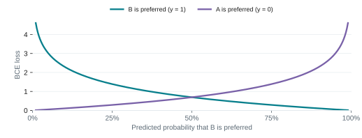
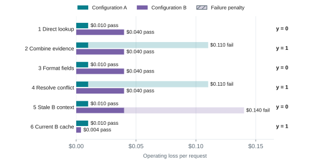
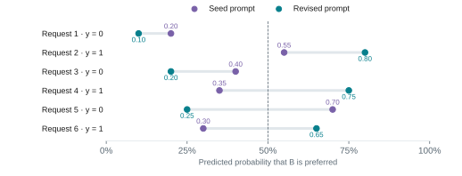
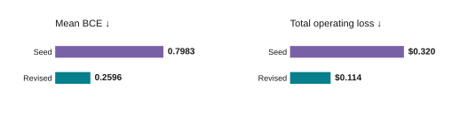
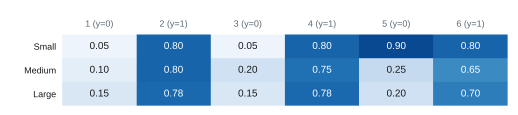
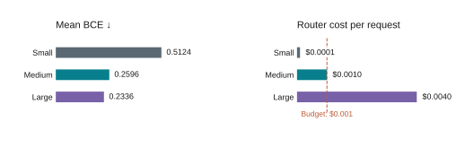

# Objectives and Loss Functions for Configuration Tuning

Configuration settings describe how the system behaves. The user's objective
describes what that behavior should achieve. Tuning connects the two through
measurement.

This guide explains how to compare configurations against a fixed objective:
define reference choices from that objective, then use a loss function to score
each candidate. For the steps to run a routing experiment, start with
[Compare and Tune](index.md).

## 1. Objectives and configuration choices

Users describe outcomes such as lower cost, higher task success, a desired
routing split, or more effective cache usage. A goal can require several settings
to change, and one setting can affect several goals. Compare candidates using
evidence tied to the objective:

- **Reduce cost while preserving accuracy.** Vary model targets, routing
  preference, and threshold. Measure total cost while meeting a defined accuracy
  requirement.
- **Maximize task success.** Vary the capable model and recovery behavior,
  including how long the router stays on the capable model. Measure successfully
  completed tasks.
- **Reach a desired routing split.** Vary routing preference and confidence
  threshold. Measure the resulting allocation between the efficient and capable
  tiers.
- **Benefit from cached context.** Vary model targets and switching behavior.
  Measure cost or latency while preserving acceptable quality.

A desired split such as 70% efficient / 30% capable still needs a rule for choosing
*which* requests use each tier. Cache benefits depend on the serving system and
workload. A setting change alone does not guarantee them. See
[model selection](../routing_algorithms/model_selection.md#counter-examples) for
examples where switching lost cache savings.

When a decision model chooses between two configurations, the objective
determines the reference labels. The loss scores the model's predictions against
those labels. We can use the same loss to compare different prompts or models.
When changing execution settings directly, compare their measured operating
outcomes.

The settings define what we can change. The objective and loss define how we
judge the change.

## 2. Outcome-based labels and binary cross-entropy

Given configurations A and B, first define "better." It might mean a correct answer
at the lowest cost, the highest task success, or a specified tradeoff between cost
and failure. Then evaluate both configurations on comparable requests.

- **y = 1:** B is preferred under the objective's labeling rule.
- **y = 0:** A is preferred under that rule. Define ties in advance; in the examples
  below, ties go to A.

The objective determines the labeling rule; measured outcomes determine each
label. Labels belong to the configurations and evaluation conditions that
produced them. If either changes, the labels may need to change too. The same
request can favor B for accuracy and A for cost.

The model predicts **p**, the probability that B is the reference choice. This is
different from the probability that B succeeds: B can succeed and still cost more
than an equally successful A. The labeling process can use completed outcomes;
the decision model must use only information available when it chooses.

For a Boolean decision question, make the event explicit: "Is B preferable to A
under this objective?" Use its answer probability as **p**. For a two-option
choice question, use the probability assigned to B. Keep answer probabilities
separate from provider confidence, and keep missing probabilities unknown rather
than turning a hard choice into certainty. See
[Decision Answers](../reference/protocols/decision_answers.md#answer-values).

Binary cross-entropy (BCE) scores that probability against the reference label:

**BCE(y, p) = −y log(p) − (1 − y) log(1 − p)**

Use natural logarithms and average the per-example losses to compare candidates.



*Figure 1. Binary cross-entropy as a function of the predicted probability of B.
The reference label determines which curve applies.*

At **p = 0.99**, loss is **0.010** when B is preferred and **4.605** when A is
preferred. BCE rewards justified confidence and penalizes confident mistakes.
Two probabilities can produce the same decision at a chosen threshold while
receiving different losses.

BCE models a binary label conditional on the input. It does not assume balanced
classes or normally distributed inputs. Expected log loss is minimized by the
true target probability, but finite tuning does not guarantee calibration.
See [Gneiting and Raftery](https://doi.org/10.1198/016214506000001437) for the
proper-scoring-rule result. Score representative workload data; artificial class
balancing changes the target distribution unless corrected.

**Probability loss is not operating cost.** A binary label records which choice
wins, but not the size of the advantage. Check actual cost, success rate, or the
other application objective alongside BCE. When the size of a mistake dominates
the objective, consider predicting each configuration's expected operating loss
directly.

## 3. Worked configuration comparison

Consider two alternative execution configurations at one pipeline stage:

- **Configuration A (Fast):** a fast executor with a 512-token generation budget;
  usual execution cost of **$0.010** per request.
- **Configuration B (Thorough):** a more capable executor with a 2,048-token
  budget and reusable context; usual cost of **$0.040**, which a verified cache
  hit can reduce.

For this example, define:

**Operating loss = execution cost + $0.10 for a failed task.**

Prefer the configuration with lower operating loss. The failure penalty is a
chosen tradeoff, not a property of BCE. All execution outcomes and prices below
are invented to show the calculation; they are not Switchyard benchmark results.



*Figure 2. Operating loss determines the reference choice for each request.
Hatched segments show the $0.10 failure penalty. Pass/fail outcomes appear beside
each bar.*

- **Request 2:** A fails, so its loss is $0.010 + $0.100 = **$0.110**. B passes
  for **$0.040**. B is preferred, giving **y = 1**.
- **Request 6:** both configurations pass. B has a verified current cache hit and
  costs **$0.004** instead of A's **$0.010**. B is preferred because of the cost
  objective, giving **y = 1**.
- **Request 5:** A has current source data while B's reusable context is stale.
  A passes and B fails, so the reference choice is A, giving **y = 0**.

The target reflects the desired outcome. The more capable executor is not always
the preferred choice. These losses exclude router inference cost; the
model-selection example adds it.

## 4. Examples of tuning

### 4.a. Prompt tuning with GEPA

**What changes:** the router instruction. **What is scored:** negative mean BCE.

GEPA improves a prompt by trying revisions. Run the decision model on labeled
examples, show another LLM where it struggled, and ask it to rewrite the
instructions. That LLM is the reflector. Evaluate the rewrite and repeat; model
weights stay fixed. DSPy provides the optimizer; supply the decision model,
examples, and scoring function. See the
[GEPA paper](https://arxiv.org/abs/2507.19457).

- **Predict and score:** run the current prompt and compute BCE against the
  reference labels.
- **Reflect and rewrite:** use the errors and their context to propose a revised
  instruction.
- **Evaluate:** compare candidate probabilities on validation data and repeat
  within the budget.

Hold the decision model, execution configurations, labels, and scoring rule fixed
while comparing prompts. Give the reflector the application, choice meanings,
inference-time inputs, current prompt, training labels, probabilities, and
measured outcomes that explain the labels.

#### Suggested reflector instruction

- Improve this decision model's instruction for the application described above.
  The reference choice minimizes execution cost plus a $0.10 penalty for failure.
- Minimize mean log loss using the supplied labels and probabilities. Keep
  uncertainty when the input is ambiguous.
- Find rules that explain several examples. You may change the structure, add
  useful domain categories, or rewrite the prompt completely.
- Use only information available at inference time. Leave out example IDs, copied
  examples, answer lists, and one-off exceptions. Return the revised instruction.

**Return `score = -loss`.** GEPA maximizes its score. Include text feedback that
explains the reference choice and the prediction's loss. With negative BCE,
failed executions must receive a sufficiently negative score; zero would
incorrectly reward failure. If probabilities are clipped for numerical stability,
choose a failure score below the worst valid clipped score. See
[DSPy's GEPA metric and failure-score interface](https://github.com/stanfordnlp/dspy/blob/main/dspy/teleprompt/gepa/gepa.py).

When decision calls are cheap, use larger reflection batches and try more prompts
within the budget. Check promising candidates on the full validation set so one
unusual batch does not decide the winner. Budget for the reflector too; repeating
identical deterministic calls adds no evidence.

Allow the reflector to reorganize rules or replace a weak framing. Avoid imposing
a short word limit before checking whether extra detail helps. Validate useful
distinctions rather than treating prompt length as evidence of overfitting.

#### Compare prompt candidates

The probabilities below are illustrative, not outputs from a live GEPA run.





*Figure 3. Seed and revised prompt probabilities (top), with mean BCE and total
operating loss (bottom). The dashed line marks the illustrative 0.5 decision
threshold.*

The revised prompt wins on probability loss: mean BCE falls from **0.7983** to
**0.2596**.

- For request 4, increasing B's probability from 0.35 to 0.75 reduces its loss from
  **1.050** to **0.288**.
- For request 5, reducing B's probability from 0.70 to 0.25 reduces its loss from
  **1.204** to **0.288**.
- At a threshold of 0.5, the seed causes two task failures and **$0.320** total
  operating loss. The revision causes no failures and **$0.114** total loss across
  six requests. These totals exclude router inference cost.

#### Illustrative revised instruction

Estimate the probability that B has lower operating loss than A. Prefer A for
routine work it can reliably complete at lower cost. Consider B when better
reasoning justifies its cost. Account for verified cache savings and stale
context. Preserve uncertainty when the evidence does not establish a clear
preference.

**Tune the threshold on validation operating outcomes.** Reuse cached
probabilities. Thresholds change decisions, not BCE. Retune after a prompt change
because the probability scale can shift.

The 0.5 cutoff here applies to the example's predicted preference probability.
The stage router's `confidence_threshold` controls an ambiguous band in a
tool-signal score; that score is not automatically a calibrated probability for
these labels. Follow the
[stage-router threshold guide](../routing_algorithms/stage_router_routing.md#tuning-confidence_threshold)
when tuning that setting. Use the probability and policy defined by the actual
decision question when applying this example to a classifier.

### 4.b. Model selection with the same loss

Now select the model that makes the A/B routing decision. Keep the prompt,
reference labels, and execution configurations fixed. Replacing an executor
would require new outcome measurements and potentially new labels. See
[Choose Models](../routing_algorithms/model_selection.md) for checks on executor
and judge compatibility.

Set a router budget of **at most $0.001 per request**. Among eligible models,
choose the lowest validation BCE and check the resulting operating outcome.
The probabilities and costs below are dummy data, not measurements of real
models.





*Figure 4. Dummy router-model probabilities, mean BCE, and inference cost. The
dashed line marks the $0.001 per-request router budget.*

- **Small:** its confident mistake on request 5 contributes a loss of **2.303**.
  Its six losses average **0.5124**.
- **Medium:** assigns only 0.25 to B on request 5, giving a loss of **0.288** and an
  overall mean of **0.2596**.
- **Large:** has the lowest mean BCE, **0.2336**, but exceeds the router budget.

**Select Medium under the stated rule.** At a 0.5 threshold:

- Small has one task failure and **$0.2446** total operating loss.
- Medium has no task failures and **$0.1200** total operating loss.
- Large also has no task failures but costs **$0.1380**.

These totals include execution, failure penalties, and router inference. Medium
and Large make the same decisions here. Large's better probability loss does not
improve the observed task outcomes, so its extra inference cost is not justified
on this sample. The six invented cases illustrate the selection rule; they are
not evidence about real models.

### Reproduce the calculations

This example uses only the Python standard library. It reproduces the labels,
mean BCE, task failures, and operating losses for both comparisons without
calling any models. GEPA itself runs separately through DSPy and a configured
decision model and reflector.

```python
import math
from statistics import mean

# Rows 1–6: (A execution cost, A passes, B execution cost, B passes).
outcomes = [
    (0.010, True, 0.040, True),
    (0.010, False, 0.040, True),
    (0.010, True, 0.040, True),
    (0.010, False, 0.040, True),
    (0.010, True, 0.040, False),
    (0.010, True, 0.004, True),
]
failure_penalty = 0.10
loss_a = [cost_a + failure_penalty * (not pass_a)
          for cost_a, pass_a, _, _ in outcomes]
loss_b = [cost_b + failure_penalty * (not pass_b)
          for _, _, cost_b, pass_b in outcomes]
labels = [int(b < a) for a, b in zip(loss_a, loss_b)]  # Ties prefer A.


def bce(y, p):
    if not 0 <= p <= 1:
        raise ValueError("Expected a finite probability in [0, 1]")
    p = min(1 - 1e-6, max(1e-6, p))  # Avoid log(0).
    return -(y * math.log(p) + (1 - y) * math.log1p(-p))


def evaluate(probabilities, router_cost=0.0):
    assert len(probabilities) == len(outcomes)
    loss = mean(bce(y, p) for y, p in zip(labels, probabilities))
    choices = [int(p >= 0.5) for p in probabilities]  # 0 = A, 1 = B.
    total = sum((loss_b[i] if b else loss_a[i]) + router_cost
                for i, b in enumerate(choices))
    failures = sum(not outcomes[i][3 if b else 1]
                   for i, b in enumerate(choices))
    return loss, failures, total


seed = [0.20, 0.55, 0.40, 0.35, 0.70, 0.30]
revised = [0.10, 0.80, 0.20, 0.75, 0.25, 0.65]
models = {
    "Small": ([0.05, 0.80, 0.05, 0.80, 0.90, 0.80], 0.0001),
    "Medium": (revised, 0.0010),
    "Large": ([0.15, 0.78, 0.15, 0.78, 0.20, 0.70], 0.0040),
}

print("Labels:", labels)
for name, ps in {"Seed": seed, "Revised": revised}.items():
    loss, failures, total = evaluate(ps)
    print(f"{name}: BCE={loss:.4f}, failures={failures}, total=${total:.4f}")
for name, (ps, cost) in models.items():
    loss, failures, total = evaluate(ps, cost)
    print(f"{name}: BCE={loss:.4f}, failures={failures}, total=${total:.4f}")

eligible = {name: evaluate(ps, cost)[0]
            for name, (ps, cost) in models.items() if cost <= 0.001}
print("Selected:", min(eligible, key=eligible.get))
```

Expected output:

```text
Labels: [0, 1, 0, 1, 0, 1]
Seed: BCE=0.7983, failures=2, total=$0.3200
Revised: BCE=0.2596, failures=0, total=$0.1140
Small: BCE=0.5124, failures=1, total=$0.2446
Medium: BCE=0.2596, failures=0, total=$0.1200
Large: BCE=0.2336, failures=0, total=$0.1380
Selected: Medium
```

### Check the final choice

- Use training examples to guide changes, validation examples to compare
  candidates and tune thresholds, and a separate test set for the frozen choice.
- Keep related examples in the same split. If predicting future data, respect
  time when splitting. Use representative workloads and repeated trials when
  execution is stochastic.
- Record the objective, labeling rule, configurations, and evaluation conditions.
  Replacing an executor requires new measurements and potentially new labels.
- If a test result guides another rewrite, it has become development evidence.
  Use fresh data for an independent check.

Return to [Compare and Tune](index.md) to run and record the routing experiment.
