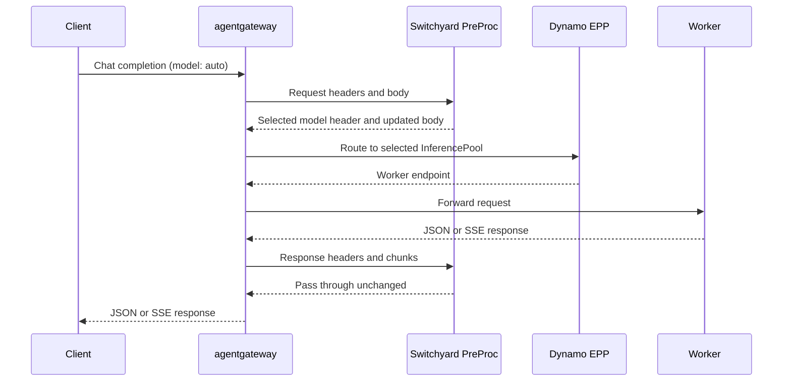

<!--
SPDX-FileCopyrightText: Copyright (c) 2025-2026 NVIDIA CORPORATION & AFFILIATES. All rights reserved.
SPDX-License-Identifier: Apache-2.0
-->

# Switchyard PreProc for Dynamo

Run Switchyard as a separate ExtProc service behind agentgateway 1.0.0. The gateway sends
an OpenAI Chat Completions request to PreProc before matching its HTTPRoute. Switchyard
chooses the model; the selected model's Dynamo EPP chooses the worker.



This directory owns the service, tests and image build. The
[Dynamo deployment example](https://github.com/ai-dynamo/dynamo/tree/main/examples/backends/sglang/deploy/gaie/switchyard)
owns the Kubernetes manifests and model-pool bindings. It assumes the cluster, gateway
controller, model workers and EPPs are already installed.

## Build the image

From the Switchyard repository root, use Docker to build and publish an image to a registry
your cluster can pull from:

```bash
export PREPROC_IMAGE=registry.example.com/your-project/switchyard-preproc:example
docker build -f examples/dynamo-preproc/Dockerfile -t "$PREPROC_IMAGE" .
docker push "$PREPROC_IMAGE"
```

Set that image in Dynamo's Kustomization and follow its deployment instructions.
The image uses the workspace Switchyard crates and precompiled Envoy bindings;
it uses the repository's shared lockfile and does not require a Dynamo checkout or a protobuf compiler.

## Configure routing

The supplied [routes.toml](config/routes.toml) uses StageRouter to choose between the two
Qwen models. Send `model: "auto"`; add `X-Switchyard-Session-Id` to retain routing state.
Send `X-Switchyard-Session-Final: true` on the final request to release its session admission
slot after a successful routing decision. Otherwise, idle slots expire after one hour.

To change routing, edit the TOML in the Dynamo deployment example and reapply its
Kustomization. Keep model IDs aligned with the HTTPRoutes and InferencePools.
Policies must select a model without generating a response or rewriting the request.

This example supports text and tool history with one PreProc replica. Routing state resets
on restart. The default StageRouter configuration does not use infrastructure signals.

## Task classification and infrastructure signals

[task-classifier.toml](config/task-classifier.toml) asks a judge whether the smaller
model can handle the task. It keeps that classification for the session. Configure the
judge endpoint to bypass PreProc so its requests cannot enter the same routing loop.
The URLs and Qwen model IDs are examples; replace them with your deployed services.

The optional `[routes.task.infra]` table adds a check after classification. For a
small-model decision, PreProc probes both models through the SDK's `InfraProvider`.
Libsy can send this request to the larger model if the small-model candidate is busy,
the larger-model candidate has spare capacity, and its estimated work score is lower.
The next request checks again; moving one request does not change its task classification.
Requests already assigned to the larger model and delegated sub-agent requests skip this check.

This needs EPP's `POST /v1/routing/probe` endpoint from the
[Dynamo probe implementation](https://github.com/ai-dynamo/dynamo/pull/16053).
Verify that your EPP image includes it. Mount the two config files and set:

```bash
ROUTES_CONFIG=/etc/switchyard/task-classifier.toml
PROBE_CONFIG=/etc/switchyard/probes.toml
```

Edit [probes.toml](config/probes.toml) with each model's EPP URL. The map keys must
match the target model IDs in the routing config. Each probe receives the original
request body with that model ID and uses that model's own preprocessing. EPP still
makes the final worker selection when the gateway forwards the request.

The work score is:

```text
(effective_prefill_tokens + active_prefill_tokens
 + active_requests * request_penalty_tokens) * prefill_cost
```

`prefill_costs` lists relative costs for the small and large models, in that order.
`min_active_requests` gates moves from the small model; `max_spillover_active_requests`
protects the large model. `min_improvement = 0.2` requires more than a 20% score reduction.
The supplied values are illustrative. Calibrate them before using them for real traffic;
this score does not predict latency. Active requests are tracked on EPP's candidate
worker, not a model pool's engine queue. Probe snapshots do not reserve capacity, so
concurrent requests can act on the same observation.

Missing, incomplete, stale or timed-out signals keep the task decision. Without
`PROBE_CONFIG`, the SDK reports signals as unavailable. Remove the `infra` table for
classification alone, or add it to a `stage_router` or `auto` route to use StageRouter
with the same infrastructure check. Logs include the task choice, final adjustment,
reason and scores; request and session IDs stay in logs, not metric labels.

## Concurrency and timeouts

agentgateway 1.0.0 sends responses through PreProc and cannot disable those phases.
Each request holds a stream slot until its response finishes. Set `MAX_ACTIVE_STREAMS` to change
the default of 16 per replica. Preprocessing also has a separate limit of eight concurrent
requests; reaching either limit returns HTTP 503. Raising the stream limit increases memory
and response-forwarding work.

Preprocessing has a five-second total deadline, including the judge and probe calls.
The classifier example gives the judge two seconds and the probe check 300 milliseconds.

PreProc allows 120 seconds of response inactivity, resetting the deadline on each message.
It also releases stream slots if output forwarding stalls for 120 seconds.
The Dynamo example's HTTPRoute uses a separate 120-second request deadline: in agentgateway
1.0.0 it bounds the wait for upstream response headers, measured from request start, rather
than the duration of an active response stream.
