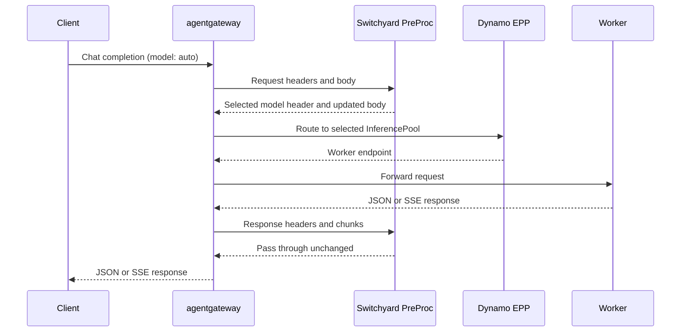

<!--
SPDX-FileCopyrightText: Copyright (c) 2025-2026 NVIDIA CORPORATION & AFFILIATES. All rights reserved.
SPDX-License-Identifier: Apache-2.0
-->

# Switchyard PreProc for Dynamo

Run Switchyard as a separate ExtProc service behind agentgateway 1.0.0. The gateway sends
an OpenAI Chat Completions request to PreProc before matching its HTTPRoute. Switchyard
chooses the model; the selected model's Dynamo EPP chooses the worker.



This directory owns the service, tests and image build. The
[Dynamo deployment example](https://github.com/ai-dynamo/dynamo/tree/main/examples/backends/sglang/deploy/gaie/switchyard)
owns the Kubernetes manifests and model-pool bindings. It assumes the cluster, gateway
controller, model workers and EPPs are already installed.

## Build the image

From the Switchyard repository root, use Docker to build and publish an image to a registry
your cluster can pull from. Replace the example registry and project below:

```bash
export PREPROC_IMAGE=registry.example.com/your-project/switchyard-preproc:example
docker build -f examples/dynamo-preproc/Dockerfile -t "$PREPROC_IMAGE" .
docker push "$PREPROC_IMAGE"
```

Set that image in Dynamo's Kustomization and follow its deployment instructions.
The image uses the workspace Switchyard crates and precompiled Envoy bindings;
it uses the repository's shared lockfile and does not require a Dynamo checkout or a protobuf compiler.

## Configure routing

The supplied [routes.toml](config/routes.toml) uses StageRouter to choose between the two
Qwen models. Send `model: "auto"`; add `X-Switchyard-Session-Id` to retain routing state.
Send `X-Switchyard-Session-Final: true` on the final request to release its session admission
slot after a successful routing decision. Otherwise, idle slots expire after one hour.

To change routing, edit the TOML in the Dynamo deployment example and reapply its
Kustomization. Keep model IDs aligned with the HTTPRoutes and InferencePools.
Policies must select a model without generating a response or rewriting the request.

This example supports text and tool history with one PreProc replica. Routing state resets
on restart. The default StageRouter configuration does not use infrastructure signals.

## Task classification and queue-based routing

[task-classifier.toml](config/task-classifier.toml) classifies the task once per session.
Its optional `infra` table lets the larger model help when every small worker reaches
`min_waiting_requests`. The larger model must have no queued requests and remain below
`max_capable_inflight`, using the greater of running and locally tracked requests.
EPP still selects the worker. This rule does not estimate waiting time or cache reuse.

Mount the routing file as `routes.toml` and [metrics.toml](config/metrics.toml), then set:

```bash
ROUTES_CONFIG=/etc/switchyard/routes.toml
METRICS_CONFIG=/etc/switchyard/metrics.toml
```

The classifier uses the existing large model through the same gateway. Its explicit
model ID matches `large_direct`, which skips classification and continues to EPP.
The judge uses temperature zero and disables Qwen thinking to leave its token budget
for the routing JSON.
Use a separate `X-Switchyard-Session-Id` per task to retain the classifier's choice.
The queue rule can still override that choice on individual requests.

This collector supports SGLang's `sglang:num_queue_reqs` and
`sglang:num_running_reqs`. Enable SGLang metrics and Prometheus scraping through
[Dynamo's monitoring setup](https://docs.nvidia.com/dynamo/dev/kubernetes/operations/observability).
Set the selectors to cover the whole pool without duplicate scrape targets or
replicated rank metrics. This example assumes Prometheus is scraping every worker;
it does not check worker health or detect a partially missing pool.

Prometheus computes the minimum and maximum queue depth and total running requests.
PreProc checks the oldest scrape time for both metrics. Failed queries, missing
aggregates or stale samples preserve the task decision. Start with one-second
scrapes and a three-second freshness limit, then validate the engine update delay.

Removing `METRICS_CONFIG` or the `infra` table leaves task routing unchanged.
StageRouter does not use this adjustment.

Use one PreProc replica. The capacity check and local increment are atomic; counts
are released when responses finish or are cancelled. Metrics can lag other traffic,
and local counts do not reserve backend capacity. Logs record the routing reason.

### Patch an existing Dynamo deployment

The [deployment patch](deploy/preproc-patch.yaml) enables this configuration on the
existing `switchyard-preproc` Deployment. It requires no Dynamo repository changes.
First enable SGLang's `--enable-metrics` and Prometheus scraping using the monitoring
setup above. Dynamo's worker PodMonitor defaults to a five-second scrape interval;
set `max_signal_age_ms` to `15000` for that interval, or use one-second scrapes with
the supplied three-second limit.

Before applying, set the model IDs in both TOML files to match your deployed HTTPRoutes,
including the ID of `large_direct`. The supplied files use the small Qwen models used
for local validation; Dynamo's current deployment example names larger models.
Check the gateway and Prometheus service URLs and the worker namespace in the selectors.
The defaults follow Dynamo's documented service names; each selector must return only
one queue and running series per engine.
For QA, also set `fail_open = false` in the task route before creating the ConfigMap,
so classifier call errors surface.

Build and push this branch's image as described above, then run from the Switchyard root:

```bash
export EXAMPLE=examples/dynamo-preproc
export AGW_NAMESPACE=agentgateway-system
kubectl -n "$AGW_NAMESPACE" create configmap switchyard-task-config \
  --from-file=routes.toml="$EXAMPLE/config/task-classifier.toml" \
  --from-file=metrics.toml="$EXAMPLE/config/metrics.toml" \
  --dry-run=client -o yaml | kubectl apply -f -
kubectl -n "$AGW_NAMESPACE" set image deployment/switchyard-preproc preproc="$PREPROC_IMAGE"
kubectl -n "$AGW_NAMESPACE" patch deployment switchyard-preproc --type=strategic \
  --patch-file "$EXAMPLE/deploy/preproc-patch.yaml"
kubectl -n "$AGW_NAMESPACE" rollout status deployment/switchyard-preproc --timeout=180s
```

For later TOML edits, reapply the ConfigMap and restart `deployment/switchyard-preproc`
with `kubectl rollout restart`; the service loads configuration only at startup.

### Check the deployment

Wait for both model workers and EPPs to be ready, then forward the gateway port.
Keep this terminal open:

```bash
kubectl -n "$AGW_NAMESPACE" port-forward service/inference-gateway 8080:80
```

In another terminal, send a small task:

```bash
curl --fail-with-body -sS http://127.0.0.1:8080/v1/chat/completions \
  -H 'Content-Type: application/json' \
  -H 'X-Switchyard-Session-Id: qa-sort-1' \
  -d '{"model":"auto","messages":[{"role":"user","content":"Sort [3,1,2] in ascending order. Return only [1,2,3]. A validator compares your output to [1,2,3]."}],"max_tokens":32,"temperature":0,"chat_template_kwargs":{"enable_thinking":false}}'
```

Repeat with the same session ID. PreProc logs should show `consulting llm judge`
only for the first request. The response's `model` shows which model served it.
These tiny Qwen models are for integration checks; their classifications can vary.

```bash
kubectl -n "$AGW_NAMESPACE" logs deployment/switchyard-preproc --since=5m
```

For a manual queue check, first establish a task that chooses the small model. Send
background traffic directly to its pool so it stays there. Once Prometheus reports
at least four waiting requests on every small worker, repeat the task request with
the same session ID. With an idle large pool, expect `small_pool_queued` and the
large model in the response. After the queue drains, expect `small_pool_not_queued`
and the small model again. If the large pool is busy, expect
`protect_capable_capacity`. Missing or stale metrics give `unknown_or_stale_signals`
and preserve the task's original choice.

This queue check requires a load generator for your deployment. The repository does
not include the workstation-specific burst driver. Record the session ID, queue
samples, response models and routing reasons to verify small → large → small.

## Concurrency and timeouts

agentgateway 1.0.0 sends responses through PreProc and cannot disable those phases.
Each request holds a stream slot until its response finishes. Set `MAX_ACTIVE_STREAMS` to change
the default of 16 per replica. Preprocessing also has a separate limit of eight concurrent
requests; reaching either limit returns HTTP 503. Raising the stream limit increases memory
and response-forwarding work.

Preprocessing has a five-second total deadline, including the classifier call.
The example gives the judge two seconds. Metrics collection is outside this deadline.

PreProc allows 120 seconds of response inactivity, resetting the deadline on each message.
It also releases stream slots if output forwarding stalls for 120 seconds.
The Dynamo example's HTTPRoute uses a separate 120-second request deadline: in agentgateway
1.0.0 it bounds the wait for upstream response headers, measured from request start, rather
than the duration of an active response stream.
