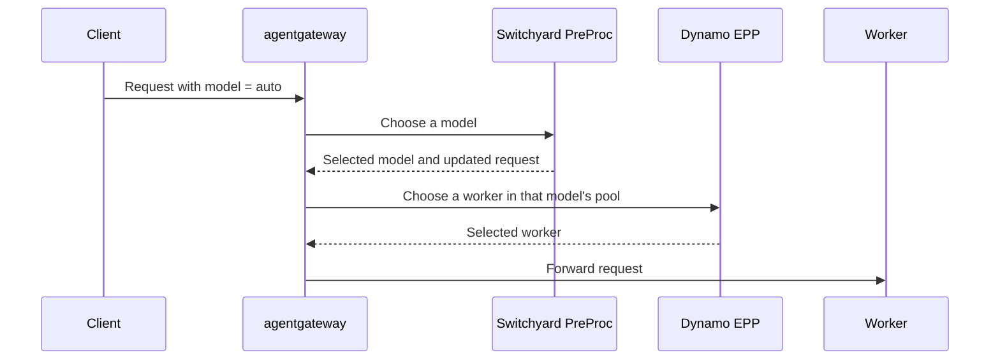

<!--
SPDX-FileCopyrightText: Copyright (c) 2025-2026 NVIDIA CORPORATION & AFFILIATES. All rights reserved.
SPDX-License-Identifier: Apache-2.0
-->

# Switchyard PreProc for Dynamo

Run Switchyard as a separate ExtProc service behind agentgateway 1.0.0. The gateway sends
an OpenAI Chat Completions request to PreProc before matching its HTTPRoute. Switchyard
chooses the model; the selected model's Dynamo EPP chooses the worker.

**Before you start:** you need an existing Kubernetes cluster with working GPU access
and `kubectl` configured to access it. This example does not create a cluster or
install GPU drivers.



This directory owns the service, tests and image build. The
[Dynamo deployment example](https://github.com/ai-dynamo/dynamo/tree/main/examples/backends/sglang/deploy/gaie/switchyard)
owns the Kubernetes manifests and model-pool bindings. It assumes the cluster, gateway
controller, model workers and EPPs are already installed.

## Build the image

From the Switchyard repository root, use Docker to build and publish an image to a registry
your cluster can pull from. Replace the example registry and project below:

```bash
export PREPROC_IMAGE=registry.example.com/your-project/switchyard-preproc:example
docker build -f examples/dynamo-preproc/Dockerfile -t "$PREPROC_IMAGE" .
docker push "$PREPROC_IMAGE"
```

Set that image in Dynamo's Kustomization and follow its deployment instructions.
The image uses the workspace Switchyard crates and precompiled Envoy bindings;
it uses the repository's shared lockfile and does not require a Dynamo checkout or a protobuf compiler.

## Configure routing

The supplied [routes.toml](config/routes.toml) uses StageRouter to choose between the two
Qwen models. Send `model: "auto"`; add `X-Switchyard-Session-Id` to retain routing state.
Send `X-Switchyard-Session-Final: true` on the final request to release its session admission
slot after a successful routing decision. Otherwise, idle slots expire after one hour.

To change routing, edit the TOML in the Dynamo deployment example and reapply its
Kustomization. Keep model IDs aligned with the HTTPRoutes and InferencePools.
Policies must select a model without generating a response or rewriting the request.

This example supports text and tool history with one PreProc replica. Routing state resets
on restart. The default StageRouter configuration does not use infrastructure signals.

## Task classification and queue-based routing

[task-classifier.toml](config/task-classifier.toml) classifies the task once per session.
Use a separate `X-Switchyard-Session-Id` per task. The classifier calls the large model
through the same gateway; `large_direct` skips classification for that explicit model ID.
Temperature zero and disabled Qwen thinking leave the judge's token budget for its verdict.

The optional `infra` rule can move an individual small-model request to the large model:

```text
every small worker has at least min_waiting_requests waiting
AND no large worker has requests waiting
AND max(total large-model running requests, local unfinished requests) < max_capable_inflight
AND both pools' samples are within max_signal_age_ms
```

Once the queue drains, requests use the original task choice again. EPP selects the
worker. This rule does not estimate waiting time or cache reuse. Removing `infra`
or `METRICS_CONFIG` disables the override; StageRouter is unaffected.

PreProc polls `sglang:num_queue_reqs` and `sglang:num_running_reqs` through the
Prometheus endpoint in [metrics.toml](config/metrics.toml). Select every engine in
each pool exactly once. Duplicate rank series or missing workers distort the counts;
this example does not detect those cases or check worker health.

Failed queries, missing aggregates or stale samples keep the task choice. Freshness
uses the oldest original scrape time, not the time of the Prometheus query.

Use one PreProc replica. Its capacity check and local increment are atomic; response
completion or cancellation releases the count. Metrics can lag other traffic, so
this is a routing guard, not a backend capacity reservation.

### Patch an existing Dynamo deployment

The [deployment patch](deploy/preproc-patch.yaml) enables this configuration on the
existing `switchyard-preproc` Deployment. It sets one replica and uses `Recreate`
updates to avoid overlapping processes with separate state. Updates interrupt service
and reset session state. No Dynamo repository changes are needed.

Enable SGLang's `--enable-metrics` and follow
[Dynamo's monitoring setup](https://docs.nvidia.com/dynamo/dev/kubernetes/operations/observability).
Dynamo's worker PodMonitor defaults to a five-second scrape interval;
set `max_signal_age_ms` to `15000` for that interval, or use one-second scrapes with
the supplied three-second limit.

Match the model IDs in both TOML files, including `large_direct`, to your HTTPRoutes.
The sample uses Qwen3-0.6B and Qwen3-1.7B; Dynamo's deployment example uses larger models.
Check the gateway and Prometheus URLs and the selectors' namespace. For QA, set
`fail_open = false` before creating the ConfigMap so classifier call errors surface.

Build and push this branch's image as described above, then run from the Switchyard root:

```bash
export EXAMPLE=examples/dynamo-preproc
export AGW_NAMESPACE=agentgateway-system
kubectl -n "$AGW_NAMESPACE" create configmap switchyard-task-config \
  --from-file=routes.toml="$EXAMPLE/config/task-classifier.toml" \
  --from-file=metrics.toml="$EXAMPLE/config/metrics.toml" \
  --dry-run=client -o yaml | kubectl apply -f -
kubectl -n "$AGW_NAMESPACE" patch deployment switchyard-preproc --type=strategic \
  --patch-file "$EXAMPLE/deploy/preproc-patch.yaml"
kubectl -n "$AGW_NAMESPACE" set image deployment/switchyard-preproc preproc="$PREPROC_IMAGE"
kubectl -n "$AGW_NAMESPACE" rollout status deployment/switchyard-preproc --timeout=180s
```

For later TOML edits, reapply the ConfigMap and restart `deployment/switchyard-preproc`
with `kubectl rollout restart`; the service loads configuration only at startup.

### Check the deployment

Wait for both model workers and EPPs to be ready, then forward the gateway port.
Keep this terminal open:

```bash
kubectl -n "$AGW_NAMESPACE" port-forward service/inference-gateway 8080:80
```

In another terminal, send a small task:

```bash
curl --fail-with-body -sS http://127.0.0.1:8080/v1/chat/completions \
  -H 'Content-Type: application/json' \
  -H 'X-Switchyard-Session-Id: qa-sort-1' \
  -d '{"model":"auto","messages":[{"role":"user","content":"Sort [3,1,2] in ascending order. Return only [1,2,3]. A validator compares your output to [1,2,3]."}],"max_tokens":32,"temperature":0,"chat_template_kwargs":{"enable_thinking":false}}'
```

Repeat with the same session ID. PreProc logs should show `consulting llm judge`
only for the first request. The response's `model` shows which model served it.
These tiny Qwen models are for integration checks; their classifications can vary.

```bash
kubectl -n "$AGW_NAMESPACE" logs deployment/switchyard-preproc --since=5m
```

For a manual queue check, use your deployment's load generator to send background
requests directly to the small pool. Keep one task session and verify:

- Quiet pool: small model, `small_pool_not_queued`.
- At least four waiting requests on every small worker, large pool idle: large model,
  `small_pool_queued`.
- Queue drained: small model again. A busy large pool gives `protect_capable_capacity`;
  missing or stale signals give `unknown_or_stale_signals` and keep the task choice.

Save the session ID, queue samples, response models and reason logs as QA evidence.

## Concurrency and timeouts

agentgateway 1.0.0 sends responses through PreProc. Each request holds a slot until its
response finishes. `MAX_ACTIVE_STREAMS` defaults to 16 **per group**: routed requests
and configured passthrough requests have separate budgets, allowing up to 32 streams.
This lets judge calls re-enter PreProc while their parent requests wait. Explicit
model requests share the passthrough budget with judges.

At most eight requests can upload their bodies at once. The upload slot is released
before calling the classifier. A full upload or stream budget returns HTTP 503.

Preprocessing has a five-second total deadline, including the classifier call.
The example gives the judge two seconds. Metrics collection is outside this deadline.

PreProc allows 120 seconds of response inactivity, resetting the deadline on each message.
It also releases stream slots if output forwarding stalls for 120 seconds.
The Dynamo example's HTTPRoute uses a separate 120-second request deadline: in agentgateway
1.0.0 it bounds the wait for upstream response headers, measured from request start, rather
than the duration of an active response stream.
