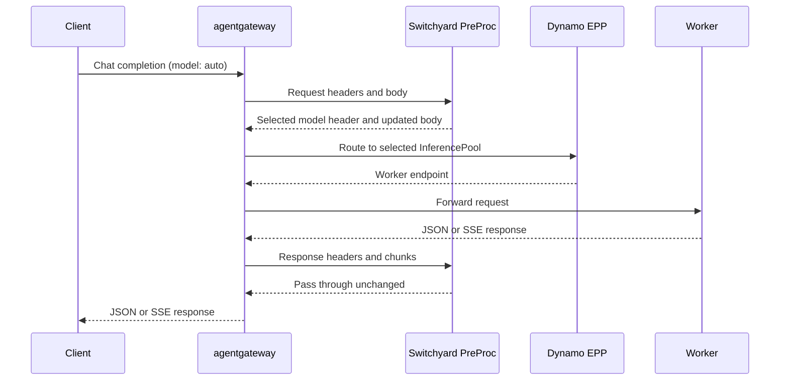

<!--
SPDX-FileCopyrightText: Copyright (c) 2025-2026 NVIDIA CORPORATION & AFFILIATES. All rights reserved.
SPDX-License-Identifier: Apache-2.0
-->

# Switchyard PreProc for Dynamo

Run Switchyard as a separate ExtProc service behind agentgateway 1.0.0. The gateway sends
an OpenAI Chat Completions request to PreProc before matching its HTTPRoute. Switchyard
chooses the model; the selected model's Dynamo EPP chooses the worker.



This directory owns the service, tests and image build. The
[Dynamo deployment example](https://github.com/ai-dynamo/dynamo/tree/main/examples/backends/sglang/deploy/gaie/switchyard)
owns the Kubernetes manifests and model-pool bindings. It assumes the cluster, gateway
controller, model workers and EPPs are already installed.

## Build the image

From the Switchyard repository root, use Docker to build and publish an image to a registry
your cluster can pull from:

```bash
export PREPROC_IMAGE=registry.example.com/your-project/switchyard-preproc:example
docker build -f examples/dynamo-preproc/Dockerfile -t "$PREPROC_IMAGE" .
docker push "$PREPROC_IMAGE"
```

Set that image in Dynamo's Kustomization and follow its deployment instructions.
The image uses the workspace Switchyard crates and precompiled Envoy bindings;
it uses the repository's shared lockfile and does not require a Dynamo checkout or a protobuf compiler.

## Configure routing

The supplied [routes.toml](config/routes.toml) uses StageRouter to choose between the two
Qwen models. Send `model: "auto"`; add `X-Switchyard-Session-Id` to retain routing state.
Send `X-Switchyard-Session-Final: true` on the final request to release its session admission
slot after a successful routing decision. Otherwise, idle slots expire after one hour.

To change routing, edit the TOML in the Dynamo deployment example and reapply its
Kustomization. Keep model IDs aligned with the HTTPRoutes and InferencePools.
Policies must select a model without generating a response or rewriting the request.

This example supports text and tool history with one PreProc replica. Routing state resets
on restart. The default StageRouter configuration does not use infrastructure signals.

## Task classification and queue-based routing

[task-classifier.toml](config/task-classifier.toml) asks a judge whether the smaller
model can handle the task and retains that classification for the session. The judge
endpoint must bypass PreProc to avoid a routing loop. Replace the example URLs and
model IDs with your deployed services.

The optional `infra` table lets the larger model help when **all small-model workers
have queues**. It uses backend `/metrics`; no EPP probe endpoint or per-request
preprocessing is needed. EPP still selects the worker.

Mount the routing file and [metrics.toml](config/metrics.toml), then set:

```bash
ROUTES_CONFIG=/etc/switchyard/task-classifier.toml
METRICS_CONFIG=/etc/switchyard/metrics.toml
```

Configure one direct metrics endpoint per independently scheduled worker. Use labels
to select exactly one series for that worker/rank. Do not use a load-balanced Service
URL that returns an arbitrary replica. Include every worker for each model and keep
these IDs consistent with the routing file's calibration tables. This version uses
an explicit worker list; scaling or replacing workers requires updating that list.

The example scrapes every 500 ms with a 250 ms timeout and bounded concurrency.
`backend = "vllm"` reads `vllm:num_requests_running` and `vllm:num_requests_waiting`;
`backend = "sglang"` reads `sglang:num_running_reqs` and `sglang:num_queue_reqs`.
Enable the backend's metrics export and inspect its labels before configuring them.
See [Dynamo's engine metrics documentation](https://docs.nvidia.com/dynamo/reference/observability/metrics-comparison).

For each efficient worker, libsy estimates:

```text
small-model time = ceil(waiting_requests / batch_size) * batch_time_ms + request_time_ms
```

It moves the request only when every small worker has at least `min_waiting_requests`
queued and even the fastest small-worker estimate exceeds the capable model's measured
service time by more than `min_saving_ms`. With multiple capable workers, it uses the
slowest configured service time. Any capable-worker queue blocks the move.

`max_capable_inflight` limits moves using the larger of observed running requests and
all locally tracked capable-model requests. `max_spillovers` separately limits moved
requests. PreProc checks and increments these counts atomically, then holds each count
until the response finishes, times out or is cancelled. Requests whose tasks require
the capable model still go there. A temporary move does not change task classification.

All service times in the example are illustrative. Measure foreground latency and
background batch time under the expected contention before enabling this policy.
The estimate assumes a representative background request length; mixed or changing
workloads need new calibration. It does not account for this prompt's cache reuse.

Missing, ambiguous, invalid or stale metrics keep the task decision. Collection runs
in the background, so routing never waits for a scrape. Without `METRICS_CONFIG`, or
without the `infra` table, routing stays task-only. The same table also works with
`stage_router` and `auto`; delegated sub-agent requests skip the adjustment.

Run one PreProc replica for the local limits and session state. These limits only
coordinate requests passing through that process. Metrics can lag external traffic,
and the policy does not reserve worker capacity. Logs record the original task model,
the adjustment reason and estimated times. No request/session IDs are metric labels.

## Concurrency and timeouts

agentgateway 1.0.0 sends responses through PreProc and cannot disable those phases.
Each request holds a stream slot until its response finishes. Set `MAX_ACTIVE_STREAMS` to change
the default of 16 per replica. Preprocessing also has a separate limit of eight concurrent
requests; reaching either limit returns HTTP 503. Raising the stream limit increases memory
and response-forwarding work.

Preprocessing has a five-second total deadline, including the classifier call.
The example gives the judge two seconds. Metrics collection is outside this deadline.

PreProc allows 120 seconds of response inactivity, resetting the deadline on each message.
It also releases stream slots if output forwarding stalls for 120 seconds.
The Dynamo example's HTTPRoute uses a separate 120-second request deadline: in agentgateway
1.0.0 it bounds the wait for upstream response headers, measured from request start, rather
than the duration of an active response stream.
